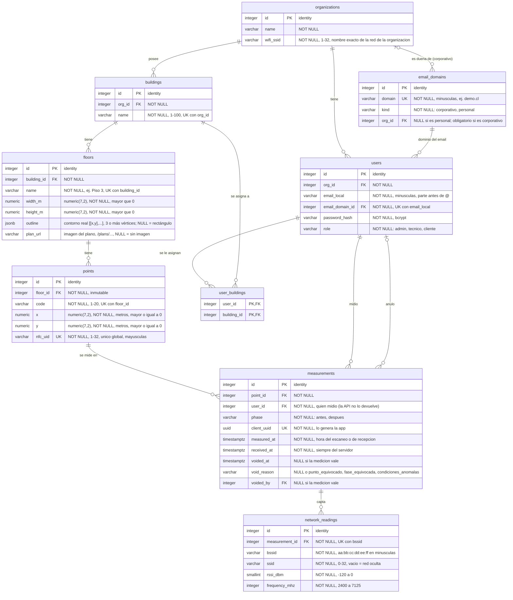

# Modelo de datos — SignalMap (Hitos 2 y 3)

> **Estado:** 7 tablas validadas el 2026-11-04 (Hito 2); `measurements` y `network_readings` y `organizations.wifi_ssid` agregadas el 2026-11-11 (Hito 3). 9 tablas. Motor: PostgreSQL 17.
> Fuente de las reglas: `docs/api-contract.md` (rutas 1 a 13 del Hito 2; 14 a 18 del Hito 3).

## Diagrama ER

## Relaciones y comportamiento al borrar

| Relación | Cardinalidad | `ON DELETE` | Por qué |
|---|---|---|---|
| `organizations` → `users` | 1 a N | `RESTRICT` | No se borra una organización con usuarios |
| `organizations` → `buildings` | 1 a N | `RESTRICT` | Ídem |
| `organizations` → `email_domains` | 1 a N (solo corporativos) | `RESTRICT` | Un dominio corporativo pertenece a una sola organización |
| `email_domains` → `users` | 1 a N | `RESTRICT` | No se borra un dominio con usuarios que lo usan |
| `buildings` → `floors` | 1 a N | `RESTRICT` | Contrato: borrar un edificio con pisos es `409`, sin cascada |
| `floors` → `points` | 1 a N | `RESTRICT` | Ídem; no se pierden puntos por borrar un piso |
| `users` ↔ `buildings` (`user_buildings`) | N a M | `CASCADE` en ambas FK | Es solo un vínculo de asignación: no debe impedir borrar un edificio sin pisos (`204`) |
| `points` → `measurements` (`point_id`) | 1 a N | `RESTRICT` | Contrato: borrar un punto con mediciones (aunque estén anuladas) es `409`; las mediciones no se pierden |
| `users` → `measurements` (`user_id`, `voided_by`) | 1 a N | `RESTRICT` | No se borra un usuario que midió o anuló: queda la trazabilidad |
| `measurements` → `network_readings` | 1 a N | `CASCADE` | Una lectura no existe sin su medición |

## Emails: corporativos primero, personales separados

El login sigue siendo solo con `email` y `password` (el contrato no cambia). El email se guarda **partido** en `email_local` + `email_domain_id`, y el dominio vive una sola vez en `email_domains`, con su tipo:

| Tipo | Ejemplo | `org_id` | Regla |
|---|---|---|---|
| `corporativo` | `demo.cl` | **Obligatorio**: la organización dueña del dominio | Dominio exclusivo de una organización |
| `personal` | `gmail.com` | `NULL` | Dominio compartido por usuarios de cualquier organización |

- **Prioridad del corporativo:** si la organización tiene un dominio corporativo, sus usuarios **deben** usarlo; un email personal solo se acepta si la organización no tiene dominio corporativo.
- **Sin repeticiones:** `UNIQUE (email_local, email_domain_id)` impide el mismo email dos veces en todo el sistema; `UNIQUE (domain)` impide registrar el mismo dominio dos veces. Todo se guarda en minúsculas (`CHECK`), así `Admin@Demo.cl` y `admin@demo.cl` son el mismo.
- **Login:** el servicio parte el email en el último `@`, pasa ambas partes a minúsculas y el repositorio busca con `JOIN email_domains`. La respuesta arma el email de nuevo (`email_local || '@' || domain`).

| Regla de email | Quién la garantiza |
|---|---|
| Dominio corporativo con dueño; personal sin dueño | Base: `CHECK ((kind = 'corporativo') = (org_id IS NOT NULL))` |
| Email y dominio únicos, en minúsculas | Base: `UNIQUE` + `CHECK (x = lower(x))` |
| Usuario con dominio corporativo pertenece a la org dueña del dominio | `npm run seed` (único camino que crea usuarios en este hito) |
| Si la org tiene dominio corporativo, no se usan personales | `npm run seed` |

> Las dos últimas reglas cruzan tablas y un `CHECK` no puede consultarlas. Cuando exista un endpoint de usuarios, pasan a su servicio.

## Números: `numeric` en la base, `number` en la API

`x`, `y`, `width_m` y `height_m` son `numeric(7,2)` (exactos al centímetro, hasta 99 999,99 m). El driver `pg` devuelve `numeric` como **texto** (`"12.50"`), pero el contrato exige números en el JSON (`12.5`). Regla obligatoria en `backend/src/repositories/README.md`.

## Reglas que cumple la base y reglas que cumple el servicio

| Regla del contrato | Quién la garantiza |
|---|---|
| `name` de edificio único por organización (`409`) | Base: `UNIQUE (org_id, name)` |
| `name` de piso único por edificio | Base: `UNIQUE (building_id, name)` (los pisos entran por seed; sin endpoint de escritura, así que no genera `409` por la API) |
| `code` único por piso (`409`) | Base: `UNIQUE (floor_id, code)` |
| `nfc_uid` único global (`409`) | Base: `UNIQUE (nfc_uid)` |
| `nfc_uid` en mayúsculas | **Servicio** convierte la entrada; base: `CHECK (nfc_uid = upper(nfc_uid))` |
| `x`, `y` con máximo 2 decimales (`400`) | **API (Zod)**: `numeric(7,2)` redondea antes de cualquier `CHECK`, así que la base no puede rechazarlo |
| Rol válido | Base: `CHECK (role IN ('admin','tecnico','cliente'))` |
| Dimensiones del piso `> 0`; `x`, `y` `>= 0` | Base: `CHECK` |
| `x <= width_m` e `y <= height_m` del piso (`422`) | **Servicio**: depende de otra tabla; un `CHECK` no puede consultarla |
| Aislamiento por organización (`404`) | **Repositorio**: `JOIN` con `buildings` y filtro por `org_id` |
| Visibilidad del `cliente` (`404`) | **Repositorio**: `JOIN` con `user_buildings` en cada consulta |
| `phase` solo `antes` o `despues` | Base: `CHECK (phase IN ('antes', 'despues'))` |
| `client_uuid` único: reenviar no duplica (`200`) | Base: `UNIQUE (client_uuid)`; el servicio devuelve la medición ya guardada |
| Anulación completa o ninguna (fecha, motivo y quién) | Base: `CHECK` de `measurements_void_chk` y lista cerrada de `void_reason` |
| Anular dos veces es `409`; no se puede des-anular | **Servicio** |
| `bssid` en minúsculas con 6 pares; `rssi_dbm` −120 a 0; `frequency_mhz` 2400 a 7125 | Base: `CHECK` (la API valida antes con Zod) |
| Un `bssid` una vez por medición | Base: `UNIQUE (measurement_id, bssid)` |
| Se guardan solo las lecturas del `wifi_ssid` de la organización | **Servicio** (comparación exacta, distingue mayúsculas) |
| `measured_at` entre los últimos 30 días y 5 minutos en el futuro (`422`) | **Servicio**: depende del reloj; un `CHECK` no sirve |
| Categoría (`buena`, `regular`, `debil`, `sin_senal`) | **Servicio** (`services/signal-category.ts`): no se guarda, se calcula |

## PostGIS

No hizo falta: con ~24 puntos por piso y coordenadas 2D en metros, ninguna consulta del Hito 3 es espacial (se listan por piso y se pintan en un plano), así que `x` e `y` siguen como `numeric`. Es la decisión revisada que preveía `CLAUDE.md`.
