# SignalMap · Hito 3 — El producto que funciona

Universidad Mayor · Facultad de Ciencias, Ingeniería y Tecnología · Escuela de Ingeniería Civil

**Documento final** · Asignatura: INGT1003 Arquitectura de Desarrollo (Móvil y Web) · Docente: Carlos Mauricio Muñoz

**Equipo:** SignalMap · **Integrantes:** Maximiliano Alvarado (`Signali`) y Gabriel Díaz (`Gabo-collab`)

**Repositorio:** https://github.com/Signali/MapeoWifiSignal

Santiago, noviembre de 2026

## 1. Introducción

Las empresas que instalan o amplían su red WiFi rara vez saben con certeza si la señal llega a cada puesto de trabajo ni si el repetidor que agregan mejoró algo. El informe del Hito 1 (Alvarado y Díaz, 2026) planteó ese problema y propuso una solución con tres piezas: tiras NFC pegadas en puntos fijos del edificio, una app Android que mide la señal WiFi al acercarle el teléfono a una tira, y una plataforma web que muestra el resultado sobre el plano del piso. El Hito 2 construyó el servidor que las une.

Este documento describe **el producto tal como quedó construido en el Hito 3**: la app del técnico, la web y el servicio funcionando juntos, de punta a punta. Un técnico acerca el teléfono a la tira del punto P-07, la app mide las redes WiFi y envía la medición, el servicio la guarda en PostgreSQL y la web pinta el punto en el plano del piso 3 de la Torre Norte como Buena, Regular o Débil. Si se recarga la página, el punto sigue pintado, porque el dato vive en la base y no en la pantalla. Sobre esas mediciones, la web también estima dónde está cada emisor de la red y dónde convendría instalar un repetidor.

**Qué encontrará el lector.** La sección 2 recorre el producto como lo recorrió el docente en la revisión: web, app y web otra vez. La sección 3 muestra la arquitectura final en tres figuras (componentes, una medición con conexión y una medición sin conexión). La sección 4 explica cómo se integraron las capas y dónde vive cada regla, y la sección 5, cómo se validaron los datos y cómo se muestran los errores y los estados de la interfaz. La sección 6 resume cómo se instala y se ejecuta el proyecto en otro equipo y qué se trabó al hacerlo. Las secciones siguientes recogen la evolución de las decisiones, las limitaciones y la conclusión; los anexos incluyen el modelo de datos completo.

---

## 2. El producto construido

El recorrido principal del producto tiene cuatro pasos: mirar el piso en la web, medir un punto con la app, ver el resultado en la web y recargar para comprobar que el dato persiste. Se usó la organización ficticia de prueba, con el edificio Torre Norte, su Piso 3 (40 m por 25 m) y 24 puntos. Tres de ellos corresponden a tiras NFC reales; el P-07, el que se mide en el recorrido, comienza sin mediciones.

### 2.1 Entrar a la web

La web pidió iniciar sesión con email y clave (Figura 1). Con el usuario administrador se eligió el edificio y el piso en la cabecera, y la fase «Antes» a la derecha. El plano mostró los 24 puntos como círculos punteados con un guion, rotulados «Sin medir», y el resumen bajo el plano indicó «Puntos medidos 0 de 24». La regla visual fue la misma en la web y en la app: línea continua para lo medido, línea punteada para lo estimado, pendiente o sin medir.

Figura 1. Inicio de sesión de la web

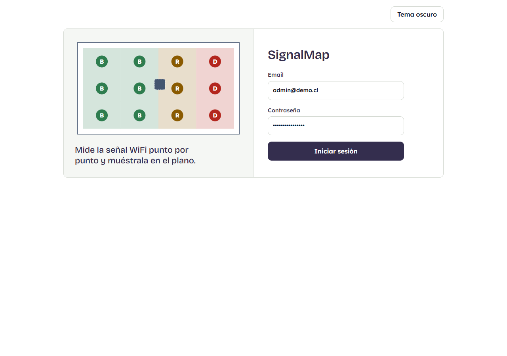

### 2.2 Medir con la app

En el teléfono, el técnico inició sesión en la app y acercó el teléfono a la tira del P-07. La app identificó el punto, mostró su código y su ubicación («Piso 3, Torre Norte») y habilitó el botón «Medir WiFi». Al pulsarlo buscó las redes cercanas y envió la medición. El resultado apareció como un bloque del color de la categoría, con su letra, su nombre y el nivel de señal, y un texto que indicó cuántas lecturas de la red de la organización se guardaron y cuántas de otras redes se descartaron (Figura 2). El sistema solo guarda las lecturas de la red WiFi de la organización; las demás se validan y se descartan, porque no son de interés para el cliente.

Figura 2. La app: el punto identificado por la tira y el resultado de la medición

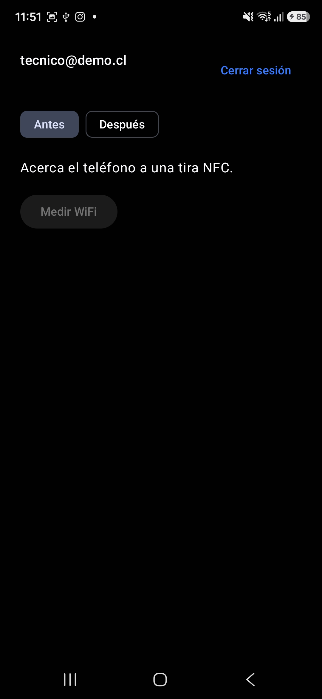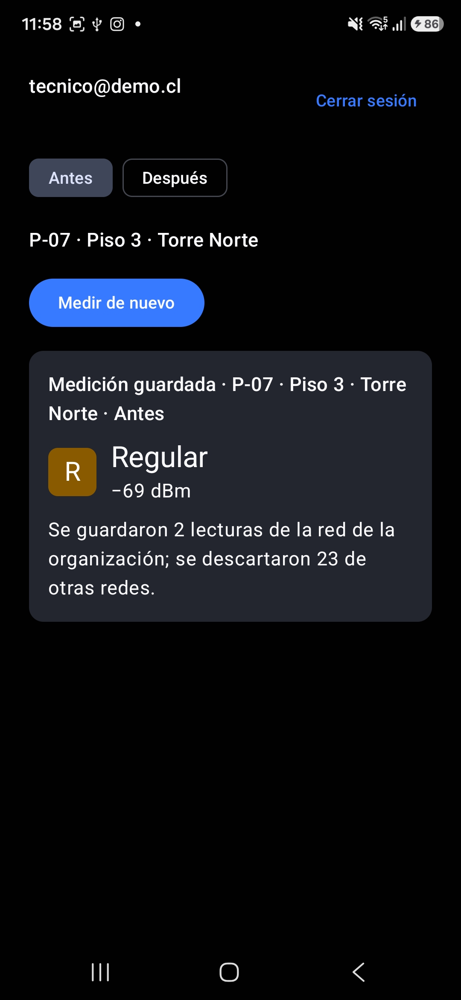

### 2.3 Ver el resultado en la web

De vuelta en la web, al pulsar «Actualizar» el P-07 apareció pintado según su categoría (Figura 3): **Buena** con una señal más fuerte que −65 dBm, **Regular** entre −65 y −70 dBm y **Débil** con una más débil que −70 dBm. El resumen pasó a «Puntos medidos 1 de 24». Cada categoría lleva color y una letra (B, R, D), de modo que no depende solo del color. Al hacer clic en el punto se abrió su detalle: categoría, nivel de señal, fecha de la medición y las redes captadas (Figura 4).

Figura 3. El plano del piso 3 en la fase «Antes», con los puntos medidos y el análisis

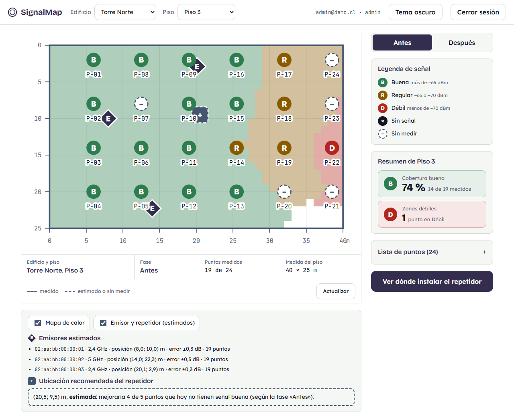

Figura 4. Detalle de un punto medido

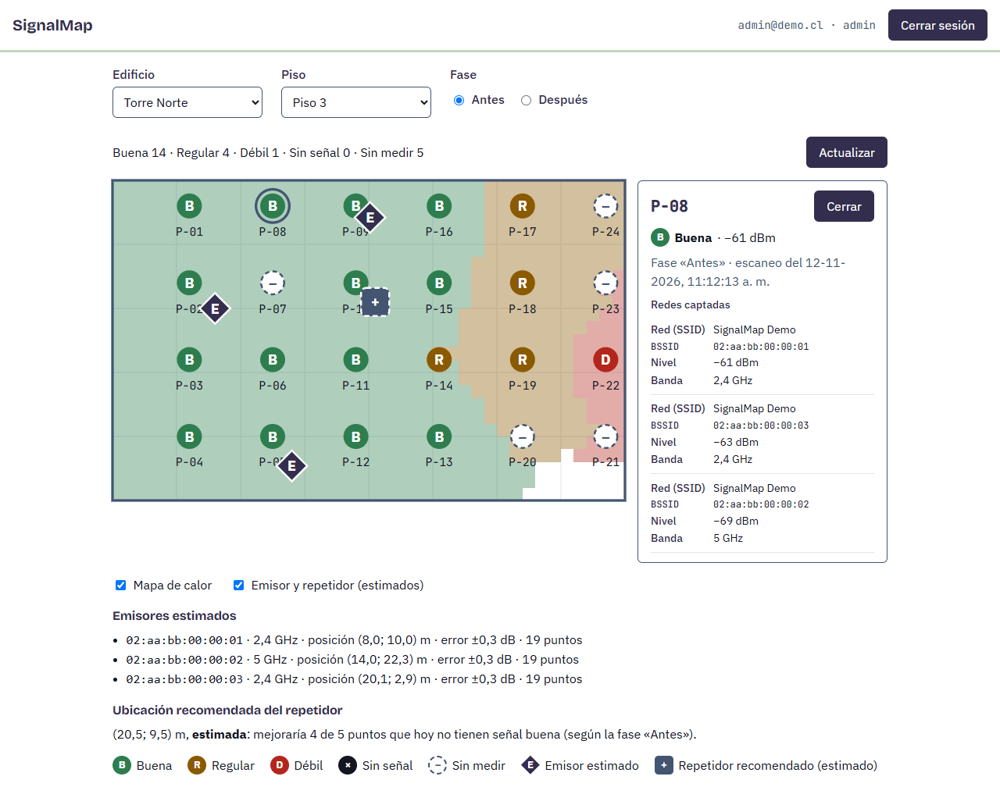

### 2.4 Recargar y analizar el piso

Al recargar la página con `F5`, el punto siguió pintado: la selección de edificio, piso y fase está en la dirección de la página y el dato viene de la base de datos. Esa fue la comprobación de que el dato persiste.

Con más puntos medidos, el panel de análisis bajo el plano ofreció tres resultados, todos calculados en el servicio a partir de las mediciones: un **mapa de calor** que interpola la señal entre los puntos medidos, la **posición probable de cada emisor** de la red (trilateración, con un mínimo de tres puntos que lo hayan captado) y la **ubicación recomendada del repetidor**. Esta última se rotuló siempre como «estimada», porque es un cálculo y no una comprobación con un repetidor real. La fase «Después» existe en la base de datos, en la API y en la web, pero no se probó con un repetidor real (sección 5.3).

---

## 3. Arquitectura final

El sistema quedó como un monolito en capas con tres clientes de una misma API. La Figura 5 muestra las piezas: la app Android del técnico y la web consumen la misma API, y solo esta habla con la base de datos. La web compilada la sirve el mismo proceso de Express que atiende `/api/v1`, de modo que en la demostración hay un solo proceso, un solo puerto y ningún problema de CORS. Con un equipo de dos personas, esa fue la forma más simple que cumplía lo pedido; cada pieza adicional habría sido algo más que mantener y explicar.

Figura 5. Componentes del sistema: app Android, web y API sobre PostgreSQL

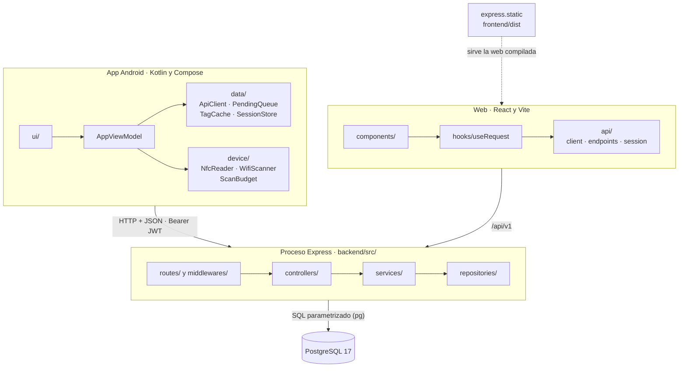

La Figura 6 sigue una medición con conexión, desde que el técnico acerca el teléfono a la tira hasta que la web la muestra en el plano. La app primero le pregunta a la API a qué punto corresponde la tira (`GET /points/by-tag`); luego mide, guarda la medición en su cola local con un identificador propio (`client_uuid`) y la envía. La API responde `201` si la medición es nueva y `200` si ese identificador ya existía, de modo que un reenvío no duplica nada. Recién entonces la app quita la medición de la cola. La web consulta después `GET /measurements` y recibe la última medición válida de cada punto.

Figura 6. Una medición con conexión: de la tira NFC al plano de la web

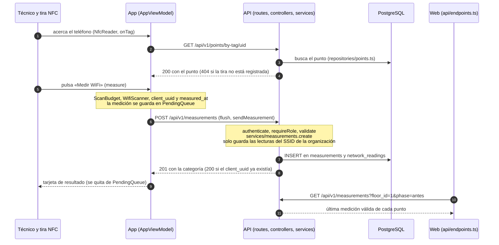

La Figura 7 muestra qué pasa cuando falta la conexión, una situación frecuente en terreno. La medición no se pierde: queda en un archivo del espacio privado de la app (`pending-measurements.json`) con el `nfc_uid` de la tira, y la app la envía cuando vuelve la red, cuando se abre de nuevo o cuando el técnico pulsa «Enviar ahora». Si la tira no se había podido identificar, se identifica al enviar. La cola funciona solo con la app abierta; no hay envío en segundo plano.

Figura 7. Una medición sin conexión: la cola de la app y el reenvío

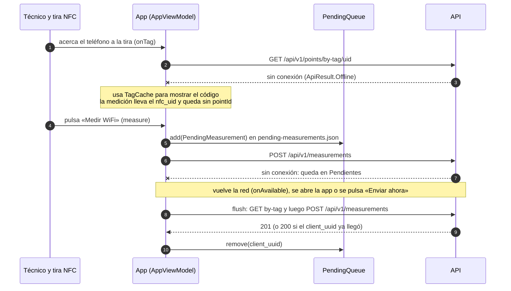

La base de datos tiene nueve tablas: las siete del Hito 2 (organizaciones, dominios de email, usuarios, edificios, pisos, puntos y asignaciones usuario–edificio) más `measurements` y `network_readings`, que guardan cada medición y las redes que captó. El Hito 3 también agregó al piso su contorno real (`outline`) y la imagen de su plano (`plan_url`). El diagrama completo es la Figura 10, en el Anexo A; es el mismo de `db/er-diagram.md` y coincide con `db/schema.sql`.

---

## 4. Integración por capas

El servicio mantuvo la arquitectura en capas del Hito 2: una petición entra por `routes/` (donde se declara qué rol puede llamar a cada ruta y qué validación aplica), pasa a `controllers/`, que traducen la petición HTTP a una llamada de negocio y la respuesta a un código de estado, luego a `services/`, donde viven las reglas, y por último a `repositories/`, el único lugar donde hay SQL. Los controladores no deciden nada: la medición, por ejemplo, la recibe `controllers/measurements.ts`, que solo elige entre `201` y `200` según lo que le informe el servicio. El Hito 3 agregó a esas capas las mediciones y el análisis del piso (`heatmap.ts`, `trilateration.ts` y `recommendation.ts`, funciones puras sin acceso a la base) sin cambiar su forma.

La Tabla 1 muestra dónde vive cada regla del producto. El criterio fue que cada regla tenga **un solo lugar**, y que los clientes muestren el resultado sin recalcularlo.

Tabla 1. Dónde vive cada regla

| Regla | Dónde vive | Qué hacen los clientes |
|---|---|---|
| Umbrales de la categoría (> −65, −65 a −70, < −70 dBm) | `backend/src/services/signal-category.ts`, función `categoryOf`; la usan las mediciones, el mapa de calor y la recomendación | La app y la web reciben `category` en cada respuesta y solo le asignan color y letra |
| Qué lecturas se guardan (solo la red WiFi de la organización) | `services/measurements.ts`, que compara el SSID con el de la organización | La app envía todas las redes que captó y el servicio descarta el resto |
| Quién puede qué (roles) | `routes/` con `requireRole`; el servicio filtra por organización y, para el cliente, por edificios asignados | La web y la app muestran lo que la API devuelve; el cliente no usa la app |
| Que no se duplique un envío | `client_uuid` único en la base; el servicio devuelve la medición ya guardada | La app genera el identificador una vez y puede reenviar sin riesgo |
| Fecha de la medición | `measured_at` opcional; el servicio rechaza lo que cae fuera de los últimos 30 días y los próximos 5 minutos | La app envía la hora del escaneo, no la del envío |
| SQL | Solo `repositories/`, con parámetros | Ningún cliente toca la base |
| Límite de 4 búsquedas WiFi cada 2 minutos de Android | `device/ScanBudget.kt` en la app | Es una regla del teléfono, no del negocio |

Hubo una repetición que no se pudo evitar: la leyenda de la web escribe como texto los umbrales («más de −65 dBm»), en `frontend/src/categories.ts`. No calcula nada con ellos, pero si los umbrales cambiaran en el servicio habría que actualizar ese texto a mano; el comentario del archivo lo advierte.

En la web, la regla fue la misma: `components/` solo presenta, `hooks/useRequest` encapsula carga, error y reintento, y todo `fetch` está en `api/`. En la app, `ui/` solo dibuja, `AppViewModel` coordina el flujo (tira, medición, cola, envío) y `data/` y `device/` aíslan lo que habla con la red, el archivo, el NFC y el WiFi.

---

## 5. Validación, errores y estados

### 5.1 Validación en el cliente y en el servidor

La entrada se validó en dos lugares, con propósitos distintos. En el cliente, la validación evita una ida y vuelta inútil y le habla al usuario: el formulario de la web y el de la app piden el email y la clave antes de llamar al servicio («Escribe tu email.», «Escribe tu contraseña.»), y la app rechaza una dirección de servidor que no empiece con `http://` o `https://`. En el servidor, la validación es la que protege los datos, porque un cliente modificado o ajeno puede saltarse la del cliente: cada endpoint tiene un esquema de Zod que se aplica antes de llegar al controlador. Por ejemplo, el esquema de una medición exige un `client_uuid` válido, entre 1 y 100 lecturas, un `bssid` con formato `aa:bb:cc:dd:ee:ff`, una señal entera entre −120 y 0 dBm y una fase que sea `antes` o `despues`, y rechaza campos desconocidos.

### 5.2 Errores con el código que corresponde

El servicio nunca respondió `200` con un error dentro. Cada falla tuvo su código HTTP y un mensaje en lenguaje de persona, con la forma `{ "message": "..." }`. La Tabla 2 reúne ejemplos reales y lo que el usuario vio en cada cliente.

Tabla 2. Errores de ejemplo y su traducción a la interfaz

| Situación | Código y mensaje del servicio | Lo que ve el usuario |
|---|---|---|
| Clave incorrecta | `401` «Credenciales inválidas» | Web y app: «Email o contraseña incorrectos.» |
| Token vencido o ausente | `401` «Token requerido» o «Token inválido» | «Tu sesión venció. Inicia sesión de nuevo.» y vuelta al inicio de sesión |
| Rol sin permiso | `403` «No tiene permiso para esta acción» | La app rechaza la cuenta de cliente: «Esta app es para técnicos y administradores. Con una cuenta de cliente, usa la web.» |
| Medición mal formada | `400` «rssi_dbm debe ser un entero entre -120 y 0» | La app arma ella misma la medición, así que este error no aparece en su uso normal; el mensaje sirve a quien consuma la API |
| Tira desconocida | `404` «Punto no encontrado» | «Esta tira no está registrada en SignalMap.» |
| Reloj del teléfono desfasado | `422` «measured_at debe estar entre los últimos 30 días y ahora» | «El servidor no aceptó la medición.» |
| Identificador de envío ya usado por otra organización | `409` «client_uuid ya fue usado» | «El servidor no aceptó la medición.» |
| Falla interna | `500` «Error interno del servidor» (el detalle va solo al registro) | «El servidor tuvo un problema. La medición sigue guardada en el teléfono y se reintentará.» |
| Sin conexión | no hay respuesta | Web: «No se pudo conectar con el servidor. Revisa que el servicio esté encendido.» App: la medición queda pendiente |

Un detalle de diseño: un recurso de otra organización responde `404` y no `403`, para no revelar que existe. Y una medición que ya llegó, reenviada desde la cola, responde `200` con la guardada, en lugar de un error de duplicado.

### 5.3 Estados de carga, vacío y error

La web mostró siempre uno de los tres estados, con el componente `StatusMessage`. Mientras cargaba: «Cargando edificios…» y «Cargando el plano…». Cuando no había nada que mostrar: «Este piso no tiene puntos de medición.», «Este edificio todavía no tiene pisos cargados.» o, en la fase «Después», «Todavía no hay mediciones en la fase «Después» en este piso.» (Figura 8). Y ante una falla, el mensaje del error con un botón «Reintentar». El `useRequest` descarta además las respuestas de pedidos viejos, de modo que cambiar de piso rápido no deja en pantalla datos del piso anterior.

Figura 8. Estado vacío de la web en la fase «Después»

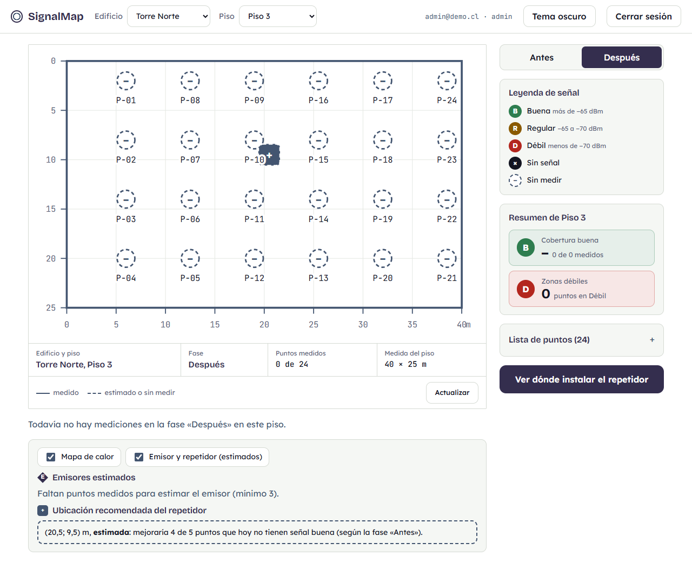

La app tuvo sus propios estados: «Buscando el punto…», «Buscando redes WiFi…» y «Enviando la medición…» mientras trabajaba, avisos específicos cuando faltaba algo en el teléfono (NFC apagado, WiFi apagado, ubicación apagada o permiso denegado) y la tarjeta de pendientes de borde punteado (Figura 9) cuando una medición no pudo enviarse. La fase «Después» está construida de punta a punta, pero se probó solo hasta el estado vacío; no se comprobó con un repetidor real.

Figura 9. La app con una medición pendiente por falta de conexión

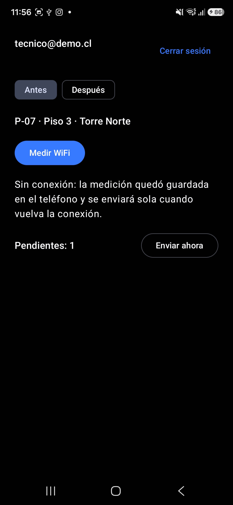

---

## 6. Ejecución reproducible

El manual de uso e instalación (`docs/manual.md`) describe cómo levantar el proyecto en otro equipo; el `README.md` de la raíz trae su resumen. Los requisitos son Windows 11 o equivalente, Node.js 26, PostgreSQL 17, Git y, para la app, un teléfono Android 10 o superior con NFC, `adb` y tres tiras NFC. La instalación sigue seis pasos:

1. Clonar el repositorio.
2. Crear el rol y las bases de datos y cargar las nueve tablas con `db/schema.sql`.
3. Copiar `.env.example` a `.env` y completar las claves. La más delicada es `SEED_WIFI_SSID`, el nombre exacto de la red WiFi que se mide.
4. Cargar los datos de prueba con `npm run seed` (crea una organización ficticia, Torre Norte, 24 puntos y tres usuarios, uno por rol; las claves son las del `.env`, no hay ninguna en el repositorio).
5. Compilar la web con `npm run build` e iniciar el servicio con `npm start`.
6. Instalar el APK de depuración en el teléfono y conectarlo al servicio con `adb reverse tcp:3000 tcp:3000`.

Por WiFi, sin cable, la app usa HTTPS con una autoridad certificadora propia de la demostración (sección 7 del manual); con cable no hace falta, porque el tráfico no sale del computador. El manual cierra con las tres fallas más frecuentes: la codificación de `psql` en Windows, un teléfono que no alcanza al servicio y un nombre de red WiFi que no coincide con el real.

### 6.1 Lo que se trabó

El proyecto se probó en un equipo distinto del de desarrollo en dos ocasiones. El 6 de noviembre, un equipo nuevo con Windows 11, PostgreSQL 17 y Node 26, siguiendo solo los README, levantó el servicio del Hito 2: la carga de datos, `/health`, la revisión de tipos y los tests quedaron en verde. Se trabaron tres pasos que los README no traían: la codificación UTF-8 de `psql`, que PostgreSQL no quedara en el `PATH` y la política de ejecución de PowerShell, que impedía correr `npm`. Los tres pasaron a los README.

El 12 de noviembre, la prueba real con un teléfono por WiFi, sin cable, dio con una trampa del entorno: en la red de la universidad, el teléfono estaba conectado pero sin haber iniciado sesión en el portal de la red, y Android enviaba el tráfico por datos móviles, de modo que la dirección local del computador era inalcanzable. Se resolvió iniciando sesión en el portal y apagando los datos móviles, y la medición llegó por HTTPS. También quedó documentado un error de configuración real: con `Wifi_Sala` en el `.env` y la red llamada `WiFi_Sala`, una sola mayúscula de diferencia, todos los puntos quedaron en «Sin señal», porque el servicio descarta las lecturas de cualquier otra red.

PENDIENTE T22: resultado del ensayo en equipo limpio en PC-Gabriel (clon nuevo, bases recreadas, solo con el README y el manual, y recorrido con el teléfono): qué se trabó en cada paso, cuánto se demoró y qué se corrigió en el README o el manual. Se completa con el informe de Gabriel antes de generar el PDF definitivo.

---

## 7. Evolución de decisiones

La Tabla 3 es la bitácora de las decisiones que más cambiaron el producto desde el informe del Hito 1 (Alvarado y Díaz, 2026), en orden cronológico. Cada fila indica la fecha, qué se decidió, qué se descartó, por qué y, cuando ocurrió, qué salió mal y cómo se resolvió. Las fechas de los días 4 a 9 de noviembre corresponden al Hito 2 y las siguientes, al Hito 3.

Tabla 3. Bitácora de decisiones

| Fecha (2026) | Decisión | Alternativas | Motivo | Qué salió mal y cómo se resolvió |
|---|---|---|---|---|
| 04-11 | TypeScript ejecutado directamente por Node 26, sin compilar; `tsc` solo revisa tipos | Compilar a `dist/` con `tsc` | Sin dependencias ni paso de build | Costo asumido: no se pueden usar `enum`, `namespace` ni propiedades de parámetro, y el proyecto depende de la versión de Node. Quedó fijada en `.nvmrc` y `engines` |
| 04-11 | `pg` con SQL explícito y parámetros, sin ORM, solo en `repositories/` (comparación escrita el 06-11) | Prisma; Knex o Kysely | El SQL se ve y se explica tal cual; menos capas con dos personas | `numeric` se entrega como texto en `pg`: se fijó un único `setTypeParser` global y un test recorre todas las columnas `numeric` |
| 04-11 | Errores con forma `{ "message": "..." }`; el código HTTP da la clase del error (el Hito 1 usaba códigos con nombre, como `TAG_UNKNOWN`) | Un campo `code` por error | El código HTTP y el mensaje bastan a los clientes | La app y la web traducen por código HTTP a mensajes propios (Tabla 2). Agregar un `code` sigue siendo un cambio compatible |
| 04-11 | JWT HS256 propio con `node:crypto` | Librería de JWT | Cero dependencias nuevas | La verificación pasó a ser responsabilidad del proyecto: tests para `alg` distinto de HS256 (incluido `none`), firma alterada, secreto distinto, token vencido y token deforme, siempre `401` |
| 04-11 (medido el 09-11) | `bcryptjs` para las claves | `bcrypt` nativo | No compila al instalarse; igual en cualquier equipo | El documento del Hito 2 decía entre 60 y 100 ms por hash; en la prueba de carga un login costó unos 183 ms y, al ejecutarse en el único hilo de Node, con tres logins simultáneos `GET /health` subió de 2 ms a cerca de 180 ms. Se declaró como límite conocido; no se cambió el código (sección 9) |
| 04-11 | PostgreSQL 17 instalado en cada equipo, sin contenedores | Docker; servicio en la nube | Menos piezas que explicar y probar | El ensayo del 06-11 en un equipo nuevo (Windows 11) se trabó en tres pasos que los README no traían: codificación UTF-8 de `psql`, `PATH` de PostgreSQL y política de ejecución de PowerShell. Los tres se agregaron a los README |
| 04-11 y 11-11 | PostGIS: el Hito 1 la declaraba y decía que se implementaría en el Hito 2; el 04-11 se difirió al Hito 3 con la condición de escribir antes la consulta espacial que la justificara; el 11-11 se acordó hacer el cálculo en TypeScript y evaluar PostGIS solo con el núcleo cerrado. **No se instaló** | (a) PostGIS para el mapa de calor y la cobertura; (b) todo en memoria; (c) memoria primero y PostGIS después, si sobraba tiempo | Con unos 24 puntos por piso el cálculo en memoria rinde igual y es más fácil de probar con datos sintéticos. Instalarla exigía la extensión en los tres equipos, otra imagen en el CI y recrear las bases, con riesgo para el arranque en el equipo del docente | Al revisar el alcance el 11-11 apareció que el mapa de calor y la recomendación sí hacen consultas espaciales (puntos dentro de un radio, cobertura por posición candidata), de modo que la razón original, «no hay consulta espacial», dejó de valer. La razón que quedó fue el costo y el riesgo; el cálculo vive en funciones puras (`heatmap.ts`, `trilateration.ts`, `recommendation.ts`) |
| 10-11 | Flujo principal con el sistema real del Hito 1: app Android que lee la tira por NFC (`enableReaderMode`, solo con «Medir» visible) y mide con `WifiManager` | Solo puntos cargados desde la web; emulador; despacho en primer plano; filtro en el manifiesto | El enunciado evalúa el recorrido completo; con un emulador la medición habría sido simulada | Era el riesgo principal del plan (permisos y límites de Android). Android permite 4 búsquedas cada 2 minutos: la app lleva su propio contador con cuenta regresiva y no guarda nada si el sistema devuelve resultados viejos. El UID de la tira se normaliza a hexadecimal en mayúsculas |
| 10-11 | Solo se guardan las lecturas de la red WiFi de la organización (SSID cargado por seed); las demás se descartan sin guardarse | Colorear por la red más fuerte de todas; guardar todas las redes | Para comparar el efecto de un repetidor importa la red de la empresa, y los BSSID de vecinos o de puntos de acceso personales podrían identificar personas (minimización) | El 12-11 una sola mayúscula de diferencia entre `Wifi_Sala` (en `.env`) y `WiFi_Sala` (la red real) dejó todos los puntos en «Sin señal». Se documentó en el manual como una de las tres fallas frecuentes |
| 10-11 (implementada el 11-11) | Una medición se anula, con un motivo de una lista fija; no se borra. Borrar un punto con mediciones responde `409` | Borrar mediciones; «medir de nuevo y vale la última» | Conserva el historial y quién anuló y cuándo; `ON DELETE RESTRICT` ya protegía la jerarquía | Sin incidentes registrados |
| 10-11 | `measured_at` lo envía la app (hora del escaneo); `received_at` lo pone siempre el servidor | Usar solo la fecha de recepción | Con la cola sin conexión, una medición antigua enviada tarde quedaría como «la última» | El reloj del teléfono pasó a definir la fecha: en la prueba iba unos 47 segundos adelantado. El servicio acepta entre los últimos 30 días y 5 minutos hacia adelante, y responde `422` fuera de eso |
| 10-11 | Cola sin conexión en un archivo JSON del espacio privado de la app, con reenvío mientras la app está abierta y `client_uuid` para no duplicar (el Hito 1 decía Room) | Room (tres dependencias y un procesador de anotaciones para pocas filas); WorkManager (envío en segundo plano); solo un botón | Cumple lo que se le informó al docente con el menor costo | El mismo 10-11 la cola quedó fuera del alcance y se retomó porque se le había informado al docente que las mediciones se enviarían al volver la conexión. La revisión del 11-11 halló que una medición pendiente podía conservar el punto de otro servidor al cambiar la dirección; se corrigió ese día |
| 10-11 | `HttpURLConnection` y `org.json`, en un solo `ApiClient.kt` | OkHttp; Retrofit | Tres llamadas no justifican dependencias ni un plugin | El primer inicio de sesión por HTTPS del 11-11 falló sin causa visible, porque la app mostraba el error real como «no se pudo conectar»; el segundo intento funcionó y no se estableció la causa del primero |
| 10-11 (rediseño el 12-11) | La web no copia el prototipo de Figma del Hito 1: se rediseñó con la paleta «aurora», plano como hoja de levantamiento y tema claro y oscuro. La app adoptó la misma identidad | Copiar el prototipo | El prototipo tenía pestañas y salas que el modelo de datos no contempla; se retomaron solo la leyenda con umbrales, el resumen del piso, los chips de puntos y el botón del repetidor | La revisión de calidad del 12-11 halló la cabecera en dos filas a 1024 px, el plano ilegible en teléfono, la falta de `h1`, un favicon inexistente y objetivos táctiles de 30 px. Se corrigieron ese mismo día |
| 10-11 y 11-11 | Docker queda fuera (el Hito 1 lo incluía para el volumen de planos). Se mantiene el diseño «listo para Docker» | Escribir `Dockerfile` y `docker-compose.yml` sin probarlos; dejar la decisión abierta | No suma puntos de rúbrica, el equipo de desarrollo no tiene WSL2 y no quedaba medio día libre sin tocar lo obligatorio | El 10-11 se había dejado «por ahora no» con un nuevo análisis el 12-11; el análisis se adelantó al 11-11 y confirmó la exclusión |
| 10-11 y 11-11 | Mapa de calor, trilateración y recomendación del repetidor vuelven al alcance: el 10-11 se habían recortado y el 11-11 se decidió incluirlos, con el reporte PDF como última pieza y primera en recortarse | Declararlos como limitación | Se prometieron en el Hito 1 | No había repetidor real ni tiempo de conseguir uno, por lo que la demostración muestra solo la fase «Antes» y la ubicación recomendada, rotulada «estimada». La prueba real del 12-11 con tres puntos produjo un emisor de 5 GHz pegado al borde del plano, con tres puntos casi alineados (sección 9). El reporte PDF no se entregó |
| 11-11 | HTTPS opcional con una autoridad certificadora propia y HTTP sin cifrar solo hacia `127.0.0.1` y `localhost` | HTTP sin cifrar en todo el APK de depuración (decisión del 10-11) | Permite usar la app por WiFi, sin cable, sin aceptar tráfico sin cifrar hacia cualquier dirección | En la prueba real del 12-11 la medición por WiFi no llegaba: el teléfono estaba en la red de la universidad sin haber iniciado sesión en su portal y Android enviaba el tráfico por datos móviles. Se resolvió iniciando sesión en el portal y apagando los datos móviles; quedó en el manual |
| 11-11 | Revisión integral (`/code-review` y `/security-review`) antes de congelar el producto | — | Un criterio de calidad más alto que el mínimo de la rúbrica | La revisión de código dio siete hallazgos. Se corrigieron ese día el análisis de otra fase al cambiar de fase, un `500` al medir un punto recién borrado, la cola con el punto de otro servidor y el mapa de calor sin recorte por el contorno. Los otros tres (`n_fixed` con distancias iguales, caché de tiras y repeticiones del análisis) se resolvieron o declararon en un PR posterior. La revisión de seguridad no halló nada |

PENDIENTE T22: fila del ensayo en equipo limpio de PC-Gabriel, con su fecha y lo que se corrigió en el README o el manual.

---

## 8. Datos personales

PENDIENTE T26: sección a cargo de Gabriel.

---

## 9. Limitaciones

Estas son las limitaciones del producto entregado, tal como estaba al cierre.
- **La cola sin conexión funciona solo con la app abierta.** La app reenvía las mediciones pendientes al abrirla, cuando Android avisa que hay red y con el botón «Enviar ahora». No hay envío en segundo plano.
- **Cifrado de la conexión.** El APK de depuración admite HTTP sin cifrar solo hacia `127.0.0.1` y `localhost` (el uso por cable con `adb reverse`). Por WiFi se usa HTTPS con una autoridad certificadora propia: su clave privada vive en un solo equipo, de modo que otro equipo debe generar la suya y recompilar la app, y el certificado del servidor dura 30 días y vale solo para una dirección IP.
- **Sin gestión de usuarios ni renovación del token.** Los usuarios se crean solo por seed y el token vence sin poder renovarse; hay que iniciar sesión de nuevo.
- **Login con límite de rendimiento.** `bcryptjs` calcula el hash en el hilo único de Node y el servicio no limita los intentos (sección 7).
- **La web no tiene pruebas automatizadas.** El servicio sí las tiene, con integración continua; la web se verificó con revisión de tipos, compilación y recorrido manual.
- **Sin Docker ni nube.** El proyecto se instala en cada equipo con los pasos de la sección 6.
- **Límite de 4 búsquedas WiFi cada 2 minutos.** Es una restricción de Android; la app lleva su propio contador y la demostración debe respetarla.
- **La fecha de una medición la define el reloj del teléfono** (`measured_at`). El servicio solo rechaza lo que cae fuera de los últimos 30 días y los próximos 5 minutos.
- **La fase «Después» y la mejora tras instalar un repetidor no se comprobaron con un repetidor real.** La fase existe en la base, la API y la web, pero solo se probó hasta el estado vacío y con datos de prueba.
- **La ubicación recomendada es una estimación.** En la prueba real del 12 de noviembre solo se observó el caso «todos los puntos tienen señal buena», en que no hay posición que recomendar; una recomendación con posición no se vio en una prueba real.
- **La posición de un emisor puede ser poco fiable con pocos puntos o casi alineados.** En esa prueba, el emisor de 5 GHz quedó en el borde del plano con tres puntos casi en línea. Con tres puntos el exponente de pérdida se fija en 3,0 y no se ajusta.
- **Una red mesh se estima por BSSID.** Los nodos de una misma red no se agrupan en un solo equipo físico.
- **No se entregó el reporte en PDF del piso.** Era la última pieza del análisis y la primera en recortarse; el contrato no incluye una ruta para él.

---

## Anexos

### Anexo A. Modelo de datos completo

La Figura 10 reúne las nueve tablas de la base de datos y sus relaciones, con las claves, las restricciones principales y los tipos de cada columna. Es el mismo diagrama de `db/er-diagram.md`, que a su vez coincide con `db/schema.sql`.

Figura 10. Modelo de datos: las 9 tablas y sus relaciones

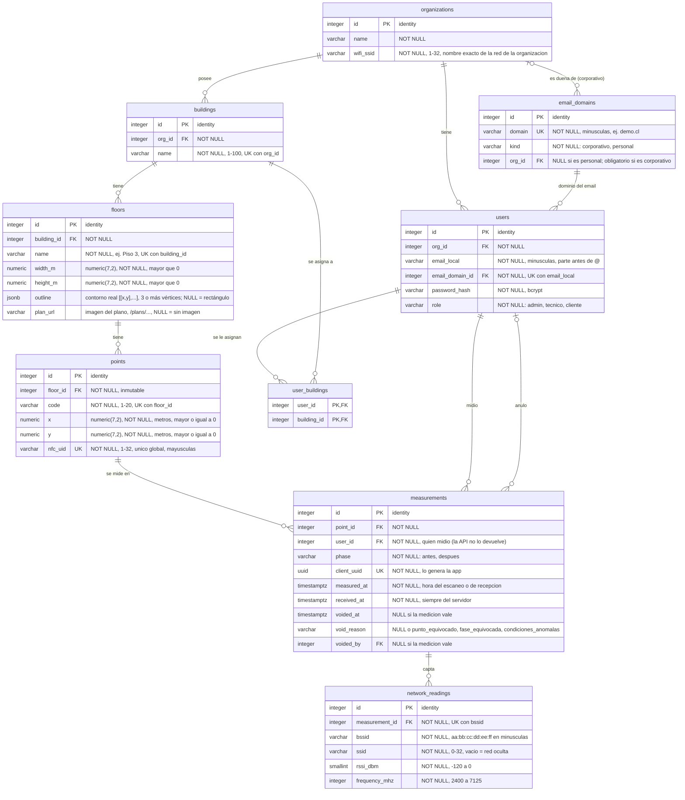
