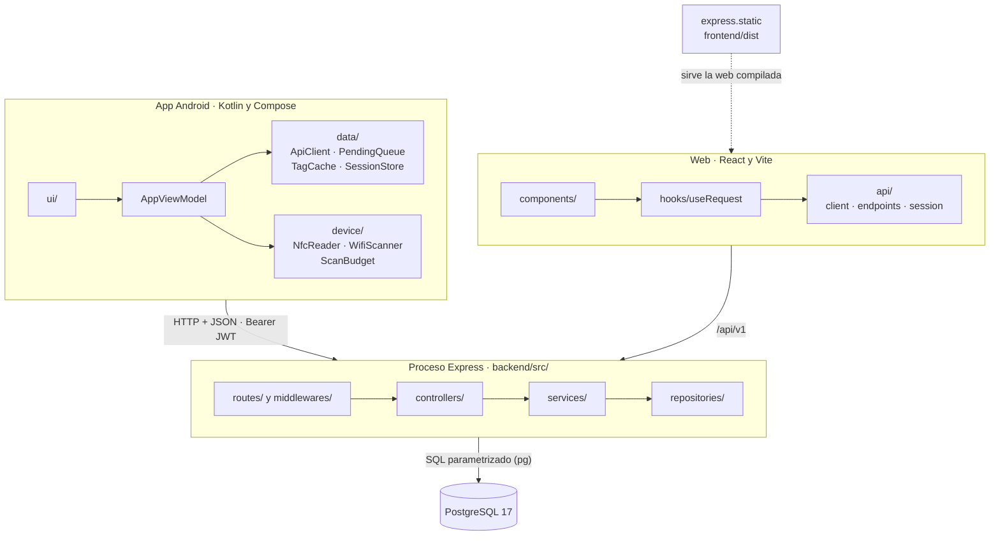
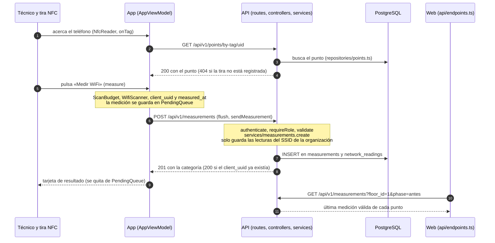
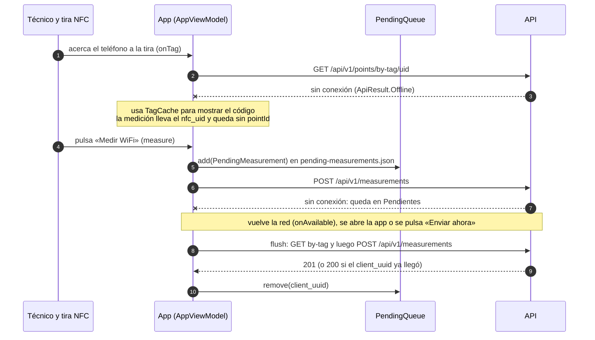
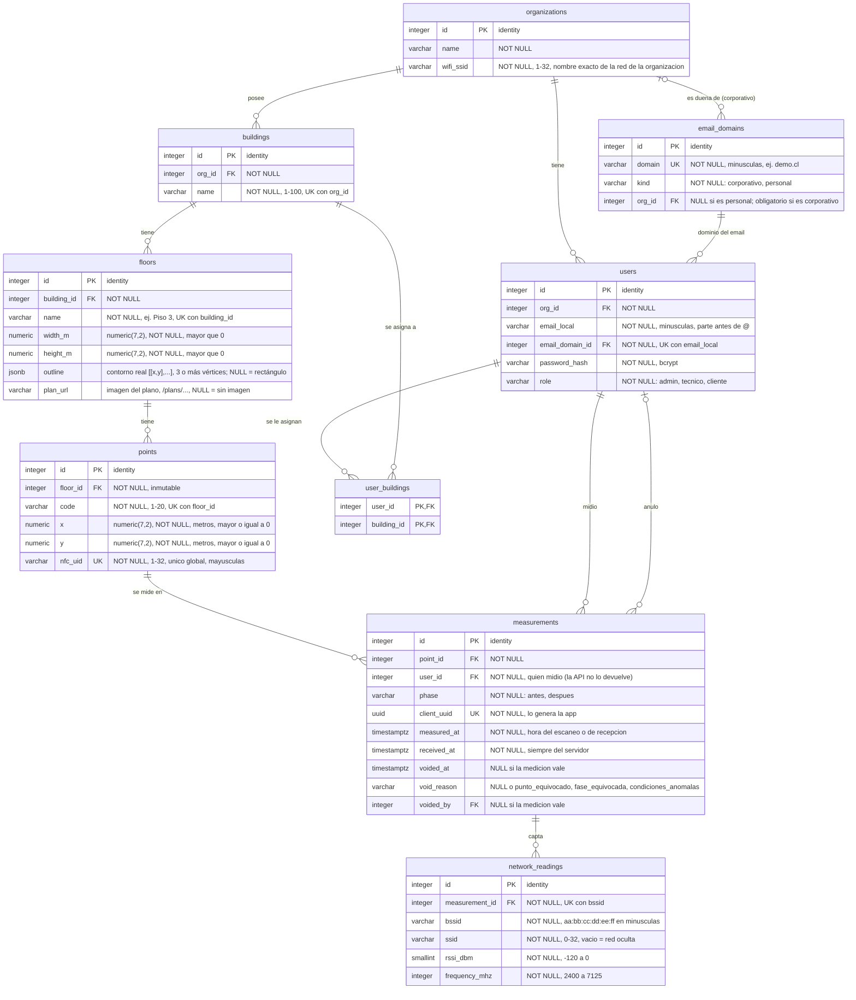

<!-- Borrador de T23: solo las figuras. T24 agrega la tapa, el índice y las secciones, y reubica este material. -->

## Figuras de la arquitectura final

La Figura 1 muestra las tres piezas del sistema y cómo se conectan: la app del técnico y la web consumen la misma API, y esta es la única que habla con la base de datos.

Figura 1. Componentes del sistema: app Android, web y API sobre PostgreSQL

La Figura 2 sigue una medición con conexión, desde que el técnico acerca el teléfono a la tira hasta que la web la muestra en el plano.

Figura 2. Una medición con conexión: de la tira NFC al plano de la web

La Figura 3 muestra qué ocurre cuando falta la conexión: la medición no se pierde, queda en la cola de la app y se envía después.

Figura 3. Una medición sin conexión: la cola de la app y el reenvío

La Figura 4 muestra las nueve tablas de la base de datos, tal como las crea `db/schema.sql`; es el mismo diagrama de `db/er-diagram.md`.

Figura 4. Modelo de datos: las 9 tablas y sus relaciones

