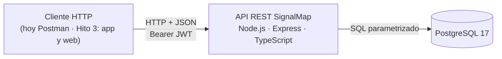

# SignalMap · Hito 2 — Motor back-end y API REST

**Documento técnico** · Universidad Mayor, Facultad de Ciencias, Ingeniería y Tecnología · Arquitectura de Desarrollo (Web y Móvil) · Docente: Carlos Mauricio Muñoz
**Equipo:** Maximiliano Alvarado (`Signali`) · Gabriel Díaz (`Gabo-collab`) · Santiago, noviembre de 2026
**Repositorio:** https://github.com/Signali/MapeoWifiSignal

<!-- BORRADOR. Secciones marcadas «Pendiente» todavía no se escriben. -->

## Resumen

*Pendiente: se escribe al final, cuando el resto esté cerrado.*

---

## 1. Introducción y alcance

El Hito 1 planteó el problema: las empresas que instalan o amplían su red WiFi no saben con certeza si la señal llega a cada puesto ni si el repetidor que agregan funciona. SignalMap lo resuelve con tiras NFC en puntos fijos del edificio, una app Android que mide la señal en esos puntos y una plataforma web que muestra el resultado antes y después de instalar el repetidor.

Este documento cubre **solo el servidor**: la API REST que esas dos aplicaciones van a usar, sus capas y la base de datos. La app y la web no se construyen en este hito.

| Qué entrega el Hito 2 | Detalle |
|---|---|
| Recursos con CRUD completo | Edificios y puntos de medición |
| Lectura | Pisos (se cargan por seed) |
| Autenticación | Login con JWT; tres roles: `admin`, `tecnico`, `cliente` |
| Interfaz | 13 endpoints bajo `/api/v1` (contrato completo en el Anexo A) |
| Persistencia | PostgreSQL 17, 7 tablas, script que crea la base desde cero |
| Ejecución | Node.js 26 + Express + TypeScript; se levanta con el README en otro equipo |

**Fuera de alcance en este hito:** campañas y mediciones, mapa de calor, comparación antes/después, trilateración, recomendación del repetidor, reporte PDF, app Android y web. Todo eso queda para el Hito 3 (sección 2).

---

## 2. Qué cambió desde el Hito 1

El Hito 1 fijó la arquitectura y el plan; al construir el servidor se ajustaron cosas. Esta sección dice qué se mantuvo, qué cambió y qué se movió al Hito 3, con su motivo y su efecto.

### 2.1 Lo que se mantiene

| Decisión del Hito 1 | Estado |
|---|---|
| Un solo back-end para la app y la web (cliente-servidor multicapa) | Se mantiene: monolito en capas (sección 3) |
| Node.js + Express + TypeScript, con Zod en cada endpoint | Se mantiene |
| PostgreSQL relacional, con la jerarquía organización → edificio → piso → punto | Se mantiene |
| Tres roles (técnico, administrador, cliente final) y JWT | Se mantiene |
| `nfc_uid` único por punto | Se mantiene, y ahora es único en todo el sistema |

### 2.2 Lo que cambió

| Hito 1 decía | Hito 2 tiene | Motivo | Efecto |
|---|---|---|---|
| Capas: middlewares, rutas y controladores juntos, servicios, repositorios (4 niveles) | 5 carpetas: `routes`, `controllers`, `services`, `repositories`, `middlewares`, más `schemas` (Zod) | Separar ruta y controlador deja ver que el controlador no tiene lógica de negocio | Cada regla de capa se revisa por archivo (sección 3) |
| Modelo de 9 entidades | 7 tablas: se agregan `email_domains` y `user_buildings` | El email se guarda partido (sin repetir el dominio) · el cliente ve solo los edificios que tiene asignados | El acceso del cliente se decide en la base, no en el token |
| Piso con «plano y dimensiones de grilla» | Piso con `width_m` y `height_m` (metros), sin imagen | No hay subida de planos en este hito | Un punto fuera del piso responde `422` |
| Punto con `x`, `y`, `nfc_uid` | Se agrega `code` (ej. `P-07`), único por piso; `nfc_uid` en hexadecimal y en mayúsculas | Identificar el punto en terreno y evitar duplicados por formato (`04a2…` = `04A2…`) | Un duplicado responde `409` |
| Errores con código propio (`404 TAG_UNKNOWN`, `409 CAMPAIGN_CLOSED`) | Código HTTP + `{ "message": "..." }` | Simplificar: el código HTTP ya dice la clase de error y el mensaje la explica | Un solo formato en toda la API. Queda abierto sumar un campo `code` con nombre junto a `message` si la app necesita distinguir dos errores con el mismo código HTTP; agregar un campo no rompe a quien solo lee `message` |
| Token vencido: `401` y renovación automática | `401` sin renovación; duración por rol (admin 8 h, técnico 10 h, cliente 2 h) | Autenticación mínima en este hito | El cliente vuelve a hacer login al vencer |
| JWT (sin detalle) | HS256 implementado con `node:crypto`, sin librería | Cero dependencias nuevas para la pieza más sensible | La verificación es nuestra: tests para cada ataque conocido (sección 6) |
| Rutas `GET /points/by-tag/:nfcUid` y `POST /measurements` | Rutas bajo `/api/v1`, todo en `snake_case`; esas dos no existen todavía | Las usa la app al medir, que es del Hito 3 | El contrato las lista como próximas |

### 2.3 Lo que se posterga

| Planteado en el Hito 1 | Ahora | Motivo | Condición para retomarlo |
|---|---|---|---|
| Ingesta real de mediciones y app con NFC y WiFi reales (ubicadas en el Hito 2) | Hito 3 | El Hito 2 se acota al servidor y su API | Contrato de campañas y mediciones acordado antes de programar |
| PostGIS (el Hito 1 la declaraba «para implementar en el Hito 2») | Hito 3, con condición | Ninguna consulta de este hito la necesita; el propio Hito 1 reconocía que no es imprescindible con ~24 puntos por piso | Se instala solo si se escribe la consulta espacial que la exige; si no, se documenta que no hace falta |
| Volumen de planos en Docker (en la arquitectura, sin hito) | Hito 3 | Sin planos ni Docker en este hito; la base corre nativa | El servicio ya está preparado: configuración por variables de entorno, escucha en `0.0.0.0` y `GET /health` |
| Gestión de usuarios por el administrador (`/admin/users`, en el mapa del producto) | Sin fecha | No es uno de los recursos de este hito; los 3 usuarios de prueba salen del seed | Se decide al planificar el Hito 3 |

---

## 3. Arquitectura: monolito en capas
*Pendiente.* Capas con su regla, recorrido de `POST /points` por las capas y decisión monolito o distribuido (equipo de 2, carga, costo de operación, despliegue y cuándo se revisaría).

## 4. Diseño de la API REST
*Pendiente.* Convenciones, tabla de los 13 endpoints, códigos de error y permisos por rol.

## 5. Datos y persistencia
*Pendiente.* Modelo de 7 tablas, borrado, qué garantiza la base y qué el servicio.

## 6. Configuración, credenciales y seguridad
*Pendiente.* Variables de entorno, manejo de secretos, JWT y portabilidad.

## 7. Decisiones de tecnología
*Pendiente.* Fichas: Express, `pg` sin ORM, JWT propio, PostgreSQL nativo, Vitest.

## 8. Calidad, riesgos y deuda técnica
*Pendiente.* Pruebas, CI, revisiones, y lo que queda pendiente con su plan.

## Referencias
*Pendiente: solo fuentes citadas y verificadas.*

## Anexos
*Pendiente.* A: contrato de la API · B: modelo de datos y script · C: instalación.
