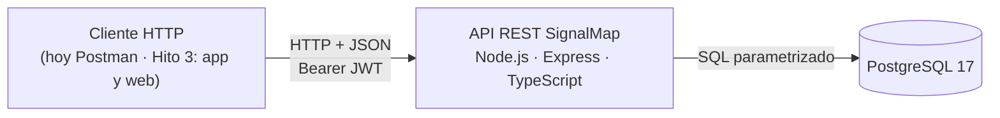
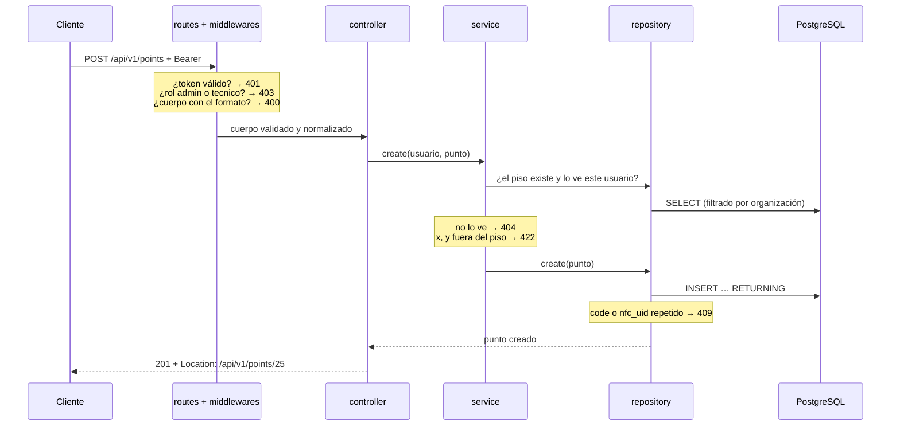
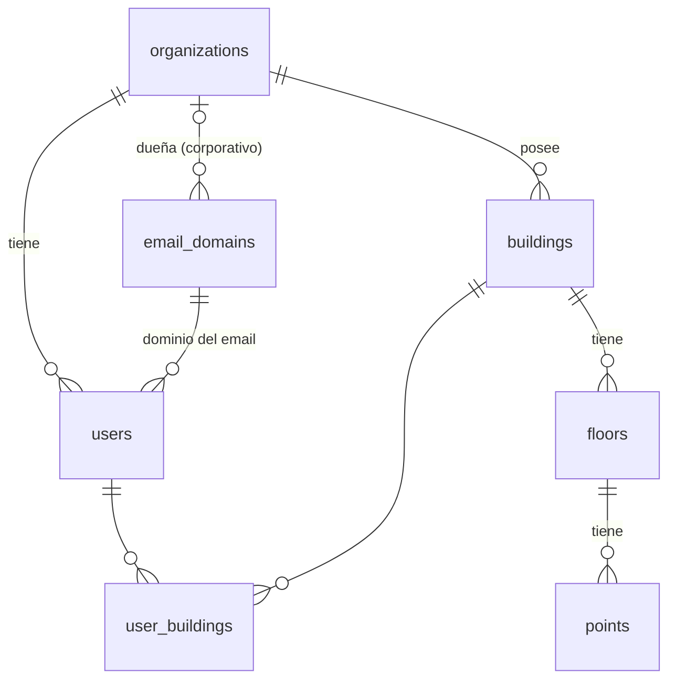

# SignalMap · Hito 2 — Motor back-end y API REST

**Documento técnico** · Universidad Mayor, Facultad de Ciencias, Ingeniería y Tecnología · Arquitectura de Desarrollo (Web y Móvil) · Docente: Carlos Mauricio Muñoz
**Equipo:** Maximiliano Alvarado (`Signali`) · Gabriel Díaz (`Gabo-collab`) · Santiago, noviembre de 2026
**Repositorio:** https://github.com/Signali/MapeoWifiSignal

<!-- BORRADOR. Secciones marcadas «Pendiente» todavía no se escriben. -->

## Resumen

*Pendiente: se escribe al final, cuando el resto esté cerrado.*

---

## 1. Introducción y alcance

El Hito 1 planteó el problema: las empresas que instalan o amplían su red WiFi no saben con certeza si la señal llega a cada puesto ni si el repetidor que agregan funciona. SignalMap lo resuelve con tiras NFC en puntos fijos del edificio, una app Android que mide la señal en esos puntos y una plataforma web que muestra el resultado antes y después de instalar el repetidor.

Este documento cubre **solo el servidor**: la API REST que esas dos aplicaciones van a usar, sus capas y la base de datos. La app y la web no se construyen en este hito.

| Qué entrega el Hito 2 | Detalle |
|---|---|
| Recursos con CRUD completo | Edificios y puntos de medición |
| Lectura | Pisos (se cargan por seed) |
| Autenticación | Login con JWT; tres roles: `admin`, `tecnico`, `cliente` |
| Interfaz | 13 endpoints bajo `/api/v1` (contrato completo en el Anexo A) |
| Persistencia | PostgreSQL 17, 7 tablas, script que crea la base desde cero |
| Ejecución | Node.js 26 + Express + TypeScript; se levanta con el README en otro equipo |



**Fuera de alcance en este hito:** campañas y mediciones, mapa de calor, comparación antes/después, trilateración, recomendación del repetidor, reporte PDF, app Android y web. Todo eso queda para el Hito 3 (sección 2).

---

## 2. Qué cambió desde el Hito 1

El Hito 1 fijó la arquitectura y el plan; al construir el servidor se ajustaron cosas. Esta sección dice qué se mantuvo, qué cambió y qué se movió al Hito 3, con su motivo y su efecto.

### 2.1 Lo que se mantiene

| Decisión del Hito 1 | Estado |
|---|---|
| Un solo back-end para la app y la web (cliente-servidor multicapa) | Se mantiene: monolito en capas (sección 3) |
| Node.js + Express + TypeScript, con Zod en cada endpoint | Se mantiene |
| PostgreSQL relacional, con la jerarquía organización → edificio → piso → punto | Se mantiene |
| Tres roles (técnico, administrador, cliente final) y JWT | Se mantiene |
| `nfc_uid` único por punto | Se mantiene, y ahora es único en todo el sistema |

### 2.2 Lo que cambió

| Hito 1 decía | Hito 2 tiene | Motivo | Efecto |
|---|---|---|---|
| Capas: middlewares, rutas y controladores juntos, servicios, repositorios (4 niveles) | 5 carpetas: `routes`, `controllers`, `services`, `repositories`, `middlewares`, más `schemas` (Zod) | Separar ruta y controlador deja ver que el controlador no tiene lógica de negocio | Cada regla de capa se revisa por archivo (sección 3) |
| Modelo de 9 entidades | 7 tablas: se agregan `email_domains` y `user_buildings` | El email se guarda partido (sin repetir el dominio) · el cliente ve solo los edificios que tiene asignados | El acceso del cliente se decide en la base, no en el token |
| Piso con «plano y dimensiones de grilla» | Piso con `width_m` y `height_m` (metros), sin imagen | No hay subida de planos en este hito | Un punto fuera del piso responde `422` |
| Punto con `x`, `y`, `nfc_uid` | Se agrega `code` (ej. `P-07`), único por piso; `nfc_uid` en hexadecimal y en mayúsculas | Identificar el punto en terreno y evitar duplicados por formato (`04a2…` = `04A2…`) | Un duplicado responde `409` |
| Errores con código propio (`404 TAG_UNKNOWN`, `409 CAMPAIGN_CLOSED`) | Código HTTP + `{ "message": "..." }` | Simplificar: el código HTTP ya dice la clase de error y el mensaje la explica | Un solo formato en toda la API. Queda abierto sumar un campo `code` con nombre junto a `message` si la app necesita distinguir dos errores con el mismo código HTTP; agregar un campo no rompe a quien solo lee `message` |
| Token vencido: `401` y renovación automática | `401` sin renovación; duración por rol (admin 8 h, técnico 10 h, cliente 2 h) | Autenticación mínima en este hito | El cliente vuelve a hacer login al vencer |
| JWT (sin detalle) | HS256 implementado con `node:crypto`, sin librería | Cero dependencias nuevas para la pieza más sensible | La verificación es nuestra: tests para cada ataque conocido (sección 6) |
| Rutas `GET /points/by-tag/:nfcUid` y `POST /measurements` | Rutas bajo `/api/v1`, todo en `snake_case`; esas dos no existen todavía | Las usa la app al medir, que es del Hito 3 | El contrato las lista como próximas |

### 2.3 Lo que se posterga

| Planteado en el Hito 1 | Ahora | Motivo | Condición para retomarlo |
|---|---|---|---|
| Ingesta real de mediciones y app con NFC y WiFi reales (ubicadas en el Hito 2) | Hito 3 | El Hito 2 se acota al servidor y su API | Contrato de campañas y mediciones acordado antes de programar |
| PostGIS (el Hito 1 la declaraba «para implementar en el Hito 2») | Hito 3, con condición | Ninguna consulta de este hito la necesita; el propio Hito 1 reconocía que no es imprescindible con ~24 puntos por piso | Se instala solo si se escribe la consulta espacial que la exige; si no, se documenta que no hace falta |
| Volumen de planos en Docker (en la arquitectura, sin hito) | Hito 3 | Sin planos ni Docker en este hito; la base corre nativa | El servicio ya está preparado: configuración por variables de entorno, escucha en `0.0.0.0` y `GET /health` |
| Gestión de usuarios por el administrador (`/admin/users`, en el mapa del producto) | Sin fecha | No es uno de los recursos de este hito; los 3 usuarios de prueba salen del seed | Se decide al planificar el Hito 3 |

---

## 3. Arquitectura: monolito en capas

Un solo servicio (Node.js + Express + TypeScript, unas 1.000 líneas en `backend/src/`) y una sola base PostgreSQL. Por dentro, cada petición atraviesa capas con una responsabilidad cada una; ninguna capa salta a otra que no le corresponde.

### 3.1 Las capas y su regla

| Capa (`backend/src/`) | Hace | No puede | Cómo se comprobó |
|---|---|---|---|
| `routes/` | Asocia verbo y ruta con la cadena de middlewares y el controlador | Tener lógica | Revisión: cada archivo es una lista de rutas |
| `middlewares/` | Token (`authenticate`), rol (`requireRole`), formato (`validate` con Zod), traducción de errores a HTTP | Reglas de negocio | Revisión de código |
| `schemas/` | Forma de la entrada y normalización (`code` a mayúsculas, `nfc_uid` hexadecimal) | Consultar la base | No importa nada de `repositories/` |
| `controllers/` | Lee la petición ya validada, llama a un servicio y elige el código de éxito | Lógica de negocio · acceso a datos | Ningún controlador importa `repositories/` |
| `services/` | Reglas de negocio: qué puede ver cada rol, punto dentro del piso, «no existe» | Conocer HTTP · escribir SQL | Ningún servicio importa `express` ni usa `res` · lanzan `AppError(tipo, mensaje)`, sin códigos HTTP |
| `repositories/` | SQL parametrizado; traduce un duplicado de la base a conflicto | Decidir permisos | **Todo el SQL del servicio está aquí**: fuera de esta carpeta no hay ninguna consulta |

Las comprobaciones de la última columna que no dicen «revisión» se hicieron con búsquedas sobre el código (resultado: cero casos), no por lectura.

Dos piezas cruzan todas las capas: `errors.ts` define seis tipos de error de negocio (`validation`, `unauthorized`, `forbidden`, `not_found`, `conflict`, `domain_rule`) y `middlewares/error-handler.ts` es el **único lugar** que los convierte en código HTTP (`400`, `401`, `403`, `404`, `409`, `422`). Por eso ningún error puede salir con `200`.

### 3.2 Una petición de punta a punta: `POST /api/v1/points`

Es la primera petición de la demostración. Cada capa responde una pregunta y, si la respuesta es «no», corta con su código:



El controlador de esa petición (`controllers/points.ts`, sin las anotaciones de tipo) tiene dos líneas y ninguna decisión:

```ts
export async function create(req, res) {
  const point = await pointsService.create(req.user!, req.body);
  res.status(201).location(`${req.baseUrl}/${point.id}`).json(point);
}
```

El orden de las preguntas es deliberado: un punto fuera del piso y además duplicado responde `422`, porque el servicio valida antes de escribir. El contrato fija ese orden (`401 → 403 → 400 → 404 → 422 → 409`).

### 3.3 Monolito o distribuido

Se eligió **monolito en capas**. Para entender el costo de cada opción se consultó a Fowler (2015), que observa que los sistemas de microservicios exitosos casi siempre empezaron como un monolito que se dividió después, cuando los límites entre servicios ya estaban claros. La decisión, sin embargo, se apoya en los datos de este proyecto:

| Criterio | Situación de SignalMap | Qué implica |
|---|---|---|
| Tamaño del equipo | 2 personas, un semestre | Varios servicios multiplican despliegue, configuración y depuración para las mismas dos personas |
| Carga esperada | ~24 puntos por piso; el técnico mide un punto a la vez y Android limita a 4 escaneos WiFi cada 2 minutos (Hito 1, §8.2) | No hay una parte del sistema que necesite escalar por separado |
| Costo de operación | Hoy: un proceso Node y una base. Hito 3: dos contenedores (API y PostgreSQL) | Un solo servicio que vigilar, con un solo `GET /health` |
| Complejidad de despliegue | Se levanta en otro equipo siguiendo un README | Con servicios separados habría que coordinar versiones y una red entre ellos |

Hay un quinto argumento propio del dominio: los datos son una jerarquía con integridad referencial (organización → edificio → piso → punto, y en el Hito 3 campaña → medición). Repartirlos entre servicios con bases distintas obligaría a garantizar esa integridad por código, que es justo lo que se eligió PostgreSQL para no hacer.

**Costo asumido:** todo escala junto y un error grave puede tumbar el servicio entero. Se acepta porque la carga es baja.

**Cuándo se revisaría:** si el análisis del Hito 3 (mapa de calor, trilateración) consumiera tanta CPU que retrasara el registro de mediciones, o si se sumaran muchas organizaciones con carga simultánea. En ese caso, lo primero que se separaría es el módulo de análisis, porque solo lee datos.

### 3.4 Tiempo de arranque

Se midió cuánto tarda el servicio desde que se lanza el proceso (`node src/server.ts`) hasta que `GET /health` responde `200`, consultando cada 2 ms. Cada serie son 10 arranques seguidos en Pc-Portatil (Intel Core i5-13420H, 24 GB de RAM, Windows 11, Node 26.13.0). `/health` no consulta la base, así que el número mide cuándo el servicio acepta peticiones, no la conexión a PostgreSQL. Se repite con `npm run startup-time` (en `backend/`, con el servicio detenido).

| Serie (10 arranques) | Mínimo | Mediana | Máximo |
|---|---|---|---|
| 1 | 725 ms | 753 ms | 5.147 ms (primer arranque, en frío) |
| 2 (`npm run startup-time`) | 785 ms | 961 ms | 1.053 ms |
| 3 | 799 ms | 932 ms | 1.027 ms |
| 4 (`npm run startup-time`) | 747 ms | 1.044 ms | 1.428 ms |
| Referencia: Node vacío (`node -e ""`) | 48 ms | 56 ms | 69 ms |

**El servicio queda listo en algo menos de un segundo** (mediana entre 0,75 y 1,04 s). La diferencia entre series es del momento en que se midió, no del método: las series 2 a 4 se corrieron seguidas, alternando dos formas de consultar `/health`, y dieron valores parecidos entre sí. La serie 1 se hizo antes, en otro momento del día. El primer arranque de la serie 1 tardó 5,1 s, el patrón de un arranque en frío (archivos todavía no cargados en memoria), que no se midió por separado.

De dónde salen los ~0,75 s (carga de cada pieza por separado, 3 corridas):

| Pieza | Tiempo |
|---|---|
| Express | ~170 ms |
| Zod | ~155 ms |
| `pg` | ~55 ms |
| El resto de `src/`: configuración, rutas y el hash ficticio de bcrypt del login (~100 ms, costo 10) | ~235 ms |
| Node en sí | ~56 ms |

El hash ficticio se calcula una vez al arrancar para que un login con un email inexistente tarde lo mismo que uno con clave incorrecta (sección 6). Es un costo de arranque aceptado a cambio de no revelar qué emails existen.

## 4. Diseño de la API REST

El contrato se escribió y se acordó entre los dos integrantes **antes de programar** (`docs/api-contract.md`, cerrado el 2026-11-04). Esta sección resume sus decisiones; el detalle de cada endpoint, con todos sus casos de error y mensajes, está en el Anexo A.

### 4.1 Convenciones

| Convención | Regla | Por qué |
|---|---|---|
| Recursos | Sustantivos en plural (`/buildings`, `/points`); el verbo HTTP dice la acción | Interfaz orientada a recursos: la misma forma para todo |
| Versión | Prefijo `/api/v1` | Un cambio incompatible (por ejemplo, IDs a UUID) sale como `v2` sin romper a la app |
| Jerarquía | Rutas planas con filtro: `/points?floor_id=1`, no `/floors/1/points` | Cada recurso tiene una sola URL, y el `id` basta para encontrarlo |
| Nombres | `snake_case` en cuerpo, respuesta y consulta | Un solo estilo en las tres partes, igual al de la base |
| Identificadores | Enteros, tratados como **opacos** por el cliente | El cliente no calcula ni ordena por ellos |
| Crear | `201 Created` + cabecera `Location` con la URL nueva + el objeto | Es lo que define HTTP para `201` (RFC 9110, §15.3.2) |
| Actualizar | Solo `PATCH`, parcial (RFC 5789); no hay `PUT` | El técnico corrige una coordenada sin reenviar el punto entero |
| Borrar | `204 No Content`, sin cuerpo | No hay nada que devolver |
| Listas | Arreglo simple, ordenado por `id`, sin paginación | ~24 puntos por piso. La paginación se decide antes del Hito 3, cuando la usen la app y la web |
| Entrada estricta | Un campo o parámetro desconocido es `400` | Un error de tipeo en el cliente (`flor_id`) no pasa en silencio |
| Aislamiento | Toda consulta se filtra por la organización del token; el cliente nunca envía `org_id` | Un usuario no puede pedir datos de otra organización aunque adivine un `id` |

### 4.2 Endpoints

| # | Verbo | Ruta | Roles | Parámetros | Éxito | Errores |
|---|---|---|---|---|---|---|
| 1 | `GET` | `/health` | público | — | `200` | — |
| 2 | `POST` | `/api/v1/auth/login` | público | cuerpo: `email`, `password` | `200` | `400` `401` |
| 3 | `GET` | `/api/v1/buildings` | todos | — | `200` | `401` |
| 4 | `GET` | `/api/v1/buildings/:id` | todos | ruta: `id` | `200` | `400` `401` `404` |
| 5 | `POST` | `/api/v1/buildings` | `admin` | cuerpo: `name` | `201` | `400` `401` `403` `409` |
| 6 | `PATCH` | `/api/v1/buildings/:id` | `admin` | ruta: `id` · cuerpo: `name` | `200` | `400` `401` `403` `404` `409` |
| 7 | `DELETE` | `/api/v1/buildings/:id` | `admin` | ruta: `id` | `204` | `400` `401` `403` `404` `409` |
| 8 | `GET` | `/api/v1/floors` | todos | consulta: `building_id` | `200` | `400` `401` `404` |
| 9 | `GET` | `/api/v1/points` | todos | consulta: `floor_id` | `200` | `400` `401` `404` |
| 10 | `GET` | `/api/v1/points/:id` | todos | ruta: `id` | `200` | `400` `401` `404` |
| 11 | `POST` | `/api/v1/points` | `admin` `tecnico` | cuerpo: `floor_id`, `code`, `x`, `y`, `nfc_uid` | `201` | `400` `401` `403` `404` `409` `422` |
| 12 | `PATCH` | `/api/v1/points/:id` | `admin` `tecnico` | ruta: `id` · cuerpo: al menos uno de `code`, `x`, `y`, `nfc_uid` | `200` | `400` `401` `403` `404` `409` `422` |
| 13 | `DELETE` | `/api/v1/points/:id` | `admin` | ruta: `id` | `204` | `400` `401` `403` `404` |

Ejemplo, la petición 11 de la tabla (la primera de la demostración):

```http
POST /api/v1/points
Authorization: Bearer eyJhbGciOi...
Content-Type: application/json

{ "floor_id": 1, "code": "P-25", "x": 30.0, "y": 12.5, "nfc_uid": "04B11C22D3E480" }
```

```http
HTTP/1.1 201 Created
Location: /api/v1/points/25

{ "id": 25, "floor_id": 1, "code": "P-25", "x": 30.0, "y": 12.5, "nfc_uid": "04B11C22D3E480" }
```

La entrada se **normaliza** antes de guardarla: `" p-07 "` y `"Ｐ－０７"` se guardan como `"P-07"`, y `04a2…` como `04A2…`. Así dos valores que se ven distintos pero son el mismo chocan como duplicado (`409`) en vez de entrar dos veces.

### 4.3 Errores

Todo error responde con su código HTTP y el mismo cuerpo: `{ "message": "Descripción clara del problema" }`. **Ninguna respuesta de error usa `200`.**

| Código | Cuándo | Ejemplo de mensaje |
|---|---|---|
| `400` | Formato: JSON mal formado, campo faltante o de otro tipo, campo desconocido, `PATCH` vacío, `id` que no es entero | `x debe ser un número con hasta 2 decimales` |
| `401` | Sin token, token inválido o vencido; login fallido. Lleva `WWW-Authenticate: Bearer`, que HTTP exige en todo `401` (RFC 9110, §15.5.2; RFC 6750, §3) | `Token vencido` |
| `403` | El rol no tiene permiso | `No tiene permiso para esta acción` |
| `404` | No existe, es de otra organización o es de un edificio no asignado al cliente | `Punto no encontrado` |
| `409` | Duplicado (`nfc_uid`, `code` en el piso, nombre del edificio) o borrar un edificio que tiene pisos | `La tira NFC ya está asociada a otro punto` |
| `413` · `415` | Cuerpo mayor a 100 kB · codificación no soportada | `Cuerpo demasiado grande` |
| `422` | Formato correcto, pero rompe una regla de dominio: coordenadas fuera del piso | `Las coordenadas quedan fuera del piso (40 x 25 m)` |
| `500` | Error inesperado; el detalle queda en el log, nunca en la respuesta | `Error interno del servidor` |

Tres decisiones de esta tabla:

- **`404` y no `403` para lo ajeno.** Un recurso de otra organización responde lo mismo que uno inexistente, para no revelar que existe. HTTP lo permite expresamente (RFC 9110, §15.5.4). El `403` queda solo para «existe y lo ves, pero tu rol no puede modificarlo».
- **`400` frente a `422`.** `"x": "doce"` es formato (`400`); `"x": 45` en un piso de 40 m es un número válido que rompe una regla del negocio (`422`, «Unprocessable Content» en RFC 9110, §15.5.21).
- **Orden fijo:** `401 → 403 → 400 → 404 → 422 → 409`. Un cliente sin permiso recibe `403` aunque su cuerpo esté mal formado: primero se sabe quién pide, después qué pide.

### 4.4 Permisos por rol

| Acción | `admin` | `tecnico` | `cliente` |
|---|:-:|:-:|:-:|
| Leer edificios, pisos y puntos | todos los de su organización | todos los de su organización | solo sus edificios asignados (otros: `404`) |
| Crear, editar y borrar edificios | sí | `403` | `403` |
| Crear y editar puntos | sí | sí | `403` |
| Borrar puntos | sí | `403` | `403` |

El técnico crea y corrige puntos porque es quien está en terreno con las tiras (Hito 1, §2.1). Borrar es irreversible (no hay papelera), así que queda solo para el administrador. Los edificios asignados a un cliente **no van en el token**: se consultan en cada petición, así que un cambio de asignación aplica de inmediato.

## 5. Datos y persistencia

Los datos viven en PostgreSQL 17, no en memoria ni en archivos: si el servicio se reinicia, todo sigue ahí. El acceso es con el driver `pg` y SQL escrito a mano, sin ORM (la comparación está en la sección 7).

### 5.1 Modelo



| Tabla | Guarda | Clave única además del `id` |
|---|---|---|
| `organizations` | La empresa cliente; raíz del aislamiento | — |
| `email_domains` | Cada dominio una sola vez, `corporativo` (con organización dueña) o `personal` (sin dueña) | `domain` |
| `users` | Email partido (`email_local` + dominio), hash bcrypt y rol | `(email_local, email_domain_id)` |
| `buildings` | Edificios de la organización | `(org_id, name)` |
| `floors` | Pisos con sus medidas en metros (`width_m`, `height_m`) | `(building_id, name)` |
| `points` | Puntos de medición: `code`, `x`, `y` en metros, `nfc_uid` | `(floor_id, code)` · `nfc_uid` en todo el sistema |
| `user_buildings` | Qué edificios ve cada cliente | `(user_id, building_id)` |

Solo `users`, `buildings` y `email_domains` tienen `org_id`. Pisos y puntos llegan a su organización por la cadena de claves foráneas hasta `buildings`, así que no hay forma de que un punto quede en una organización distinta de la de su edificio. El diagrama completo, con tipos y restricciones, está en el Anexo B.

### 5.2 Qué garantiza la base y qué el servicio

La regla general: **la base garantiza todo lo que puede comprobar sola**, para que ningún camino (la API, el seed o un error de programación) deje datos inválidos. El servicio se encarga de lo que necesita leer otra tabla o conocer a quien pregunta.

| Regla | Quién | Cómo |
|---|---|---|
| Nombre de edificio único por organización · `code` único por piso · `nfc_uid` único | Base | `UNIQUE` → el repositorio lo traduce a `409` |
| `nfc_uid` siempre en mayúsculas | Los dos | El servicio convierte la entrada; la base lo exige con `CHECK (nfc_uid = upper(nfc_uid))` |
| Medidas del piso `> 0`, coordenadas `>= 0`, rol válido | Base | `CHECK` |
| Email en minúsculas; dominio corporativo con dueña, personal sin | Base | `CHECK` |
| `x <= width_m` e `y <= height_m` del piso | Servicio | Depende de otra tabla, y un `CHECK` no puede leerla → `422` |
| `x`, `y` con más de 2 decimales | API (Zod) | `numeric(7,2)` redondearía en silencio antes de cualquier `CHECK` → `400` |
| Ver solo lo de la propia organización y, el cliente, solo lo asignado | Repositorio | Filtro por `org_id` y `JOIN` con `user_buildings` en cada consulta → `404` |

Los cambios y borrados filtran por `id` **y** organización en la misma sentencia, y miran cuántas filas tocaron: si fueron cero, el servicio responde `404`. La pertenencia se comprueba en la misma sentencia que escribe, no en una lectura previa, así que no queda una ventana entre comprobar y escribir. (Para el `422` el servicio sí lee antes las medidas del piso, pero los pisos no se modifican por la API.)

### 5.3 Borrar

Toda la jerarquía usa `ON DELETE RESTRICT`: no se borra un edificio que tiene pisos ni un piso con puntos. Por la API, borrar un edificio con pisos responde `409`: sin cascada, así borrar un edificio nunca se lleva sus pisos y puntos sin aviso. La única excepción es `user_buildings`, con `CASCADE`: es solo un vínculo de asignación y no debe impedir borrar un edificio vacío.

### 5.4 Números exactos

Coordenadas y medidas son `numeric(7,2)`: exactas al centímetro y hasta 99.999,99 m. El driver `pg` entrega `numeric` como texto (`"12.50"`), pero la API debe responder números (`12.5`). La conversión está en **un solo lugar** (un `setTypeParser` en `repositories/db.ts`) y un test recorre **todas** las columnas `numeric` del esquema, leídas de `information_schema`, para comprobar que llegan como número. Una columna `numeric` nueva queda cubierta sin tocar el test.

### 5.5 Consultas seguras

Los valores siempre viajan como parámetros (`$1`, `$2`…), nunca pegados al texto del SQL, así que un valor no puede cambiar la consulta (inyección SQL). Los únicos fragmentos que se insertan en el texto son constantes del propio código (la lista de columnas y el filtro de organización). Las columnas se nombran una por una: ninguna consulta usa `SELECT *` ni devuelve `org_id`.

### 5.6 Crear la base desde cero

| Archivo | Qué hace |
|---|---|
| `db/schema.sql` | Crea las 7 tablas en una sola transacción: o se crean todas o ninguna. Si ya existen, falla sin tocar nada. No crea la base ni el rol, así lo puede ejecutar tal cual la imagen oficial de PostgreSQL al iniciar (Hito 3) |
| `db/seed.sql` | Datos de ejemplo sin usuarios ni claves: 1 organización, 2 edificios, 1 piso de 40 × 25 m y 24 puntos (`P-07` es siempre el id 7) |
| `npm run seed` | Vacía las tablas, carga `seed.sql` y crea los 3 usuarios de prueba con las claves del `.env`, hasheadas con bcrypt. Todo en una transacción. Se niega a correr con `NODE_ENV=production` |

Los pasos para crear el rol y las bases están en `db/README.md` y en el Anexo C.

## 6. Configuración, credenciales y seguridad

### 6.1 Toda la configuración sale del entorno

El código no tiene claves, hosts ni puertos escritos: todo llega por variables de entorno. En desarrollo se leen de un `.env` en la raíz; si no existe (como pasará en Docker), se toman del entorno del proceso. `.env.example` lista todas las variables con valores de ejemplo:

| Variable | Para qué | Regla al arrancar |
|---|---|---|
| `NODE_ENV`, `PORT` | Modo y puerto del servicio | `NODE_ENV` es `development`, `test` o `production` |
| `DB_HOST`, `DB_PORT`, `DB_NAME`, `DB_USER`, `DB_PASSWORD` | Conexión a PostgreSQL | Obligatorias |
| `DB_NAME_TEST` | Base aparte para los tests, que la vacían | Distinta de `DB_NAME` |
| `JWT_SECRET` | Firma de los tokens | 32 caracteres o más, y distinta del valor de ejemplo |
| `JWT_EXPIRES_IN_ADMIN` · `_TECNICO` · `_CLIENTE` | Duración del token por rol (`8h`, `10h`, `2h`) | Entero + `s`/`m`/`h`/`d`, máximo 30 días |
| `SEED_*_PASSWORD` | Claves de los 3 usuarios de prueba | Las usa solo `npm run seed` |

`config.ts` valida todo con Zod antes de arrancar. Si falta una variable o rompe su regla, el servicio **no arranca** y dice cuál es, en vez de fallar más tarde con un error confuso. El mínimo de `JWT_SECRET` no es arbitrario: HS256 exige una clave de al menos 256 bits, es decir 32 bytes (RFC 7518, §3.2). El README indica generarla al azar con `node:crypto` (32 bytes aleatorios en base64url, 43 caracteres). El valor de ejemplo se rechaza porque es público: con él, cualquiera que lea el repositorio podría firmar tokens.

### 6.2 Credenciales fuera del repositorio

- `.gitignore` excluye `.env` y cualquier `.env.*` salvo la plantilla, más `*.pem`, `*.key` y el environment de Postman con la clave real.
- **Comprobación sobre el historial de git** (todas las ramas): el único archivo `.env…` que se subió alguna vez es `.env.example`.
- Cada equipo crea su `.env` y genera su propio `JWT_SECRET`; las claves no se comparten por chat ni por correo.
- **Regla del equipo:** si una credencial llega a un commit, se **rota** (se cambia por una nueva), no basta con borrar el archivo, porque el historial de git queda visible.
- Las contraseñas se guardan solo como hash bcrypt (costo 10). El seed las toma del `.env` al crear los usuarios: ni las claves ni sus hashes están en el repositorio.

### 6.3 Login

`POST /auth/login` responde el mismo `401 "Credenciales inválidas"` si el email no existe y si la clave es incorrecta. Además, cuando el email no existe igual se ejecuta bcrypt contra un hash ficticio. Sin eso, la respuesta rápida delataría qué emails están registrados (es el hash que se calcula al arrancar, sección 3.4). Un test comprueba que bcrypt se ejecuta en los dos casos.

### 6.4 JWT propio

El token se firma y se verifica con `node:crypto` (HMAC-SHA256), sin librería: la pieza más sensible del servicio no suma dependencias. **El costo** es que la verificación es responsabilidad nuestra. Por eso se siguió lo que recomienda RFC 8725 (§3.1): aceptar solo el algoritmo que uno espera y ningún otro. El servicio compara la cabecera del token con la única que emite (`{"alg":"HS256","typ":"JWT"}`), y cualquier otra se rechaza sin interpretarla.

La verificación sigue un orden fijo: forma y cabecera → firma (comparada en tiempo constante, para no filtrar información por el tiempo de respuesta) → contenido → vencimiento. Cada ataque conocido tiene su test, y todos terminan en `401`, nunca en `500`:

| Ataque probado | Resultado |
|---|---|
| `alg: "none"`, con y sin firma (RFC 8725, §2.1) | `401 Token inválido` |
| `alg: "RS256"` (confusión de algoritmo) y `HS512` firmado con el secreto real | `401 Token inválido` |
| Cabecera con campos extra (`kid`) | `401 Token inválido` |
| Firma alterada, con caracteres extra o fuera de base64url | `401 Token inválido` |
| Payload cambiado (`cliente` → `admin`) con la firma original | `401 Token inválido` |
| Firmado con otro secreto | `401 Token inválido` |
| Vencido, o con `exp` igual a ahora | `401 Token vencido` |
| Vencido **y** con la firma alterada | `401 Token inválido` (la firma se revisa primero: no se revela nada de un token falso) |
| 15 tokens deformes (una, dos o cuatro partes; payload no JSON; sin `role` o sin `exp`; `sub` numérico; campos extra…) | `401 Token inválido` |

El token lleva solo `sub` (el id del usuario, como texto, según RFC 7519, §4.1.2), `org_id`, `role` y `exp`. Los edificios asignados al cliente no van en el token (sección 4.4).

### 6.5 Otras defensas y lo que queda fuera

| Defensa | Dónde |
|---|---|
| Cuerpo de más de 100 kB → `413` | `express.json()` |
| Error inesperado → `500` genérico; el detalle va al log, nunca a la respuesta | `middlewares/error-handler.ts` |
| Recurso ajeno → `404`, sin revelar que existe | Repositorios (sección 4.3) |
| Entrada estricta: campos y parámetros desconocidos → `400` | Schemas de Zod |

Quedan fuera de este hito, con su plan en la sección 8: límite de intentos de login, cabeceras de seguridad (`helmet`), revocar un token antes de que venza y renovarlo sin volver a hacer login. También una limitación conocida de bcrypt: solo considera los primeros 72 bytes de la clave.

### 6.6 Portabilidad

El servicio se levanta en otro equipo siguiendo solo el README: crear el rol y las bases (`db/README.md`), copiar `.env.example` a `.env` con claves propias, `npm install`, `npm run seed` y `npm start`. Escucha en `0.0.0.0` y expone `GET /health`, que es lo que necesitará el contenedor del Hito 3.

*Pendiente: resultado del ensayo en el equipo de Gabriel (en curso).*

Para producción (Hito 3), el plan está escrito en `backend/README.md`: pasar `JWT_SECRET` como secreto de Docker (un archivo en memoria, que no aparece en `docker inspect`) y rotarlo ante cualquier sospecha, lo que invalida todos los tokens emitidos.

## 7. Decisiones de tecnología

Los criterios son los mismos para todas: un equipo de 2 personas y un semestre, el mismo lenguaje que tendrá la web (TypeScript), capas que se puedan defender, que **los dos integrantes** puedan explicar cada parte del código y una carga baja (~24 puntos por piso).

### 7.1 Framework: Express

El Hito 1 comparó Express con Spring Boot. Al empezar el Hito 2 se amplió la comparación, sin cambiar la decisión:

| Opción | Qué ofrece | Por qué no en este proyecto |
|---|---|---|
| **Express 5 (elegido)** | Rutas y middlewares, sin estructura impuesta. Muy documentado; se integra directo con Zod y Supertest | — |
| Fastify | Más rápido, validación propia con JSON Schema | Su ventaja de velocidad no se nota con esta carga, y suma un sistema de plugins por aprender |
| NestJS | Estructura impuesta: módulos, decoradores, inyección de dependencias | Para 2 personas y 2 recursos, la ceremonia cuesta más de lo que ordena |
| Hono | Muy liviano y portable entre entornos | Su fuerte son las funciones en el borde de la red (*edge*), que no usamos |
| Spring Boot | Estructura y seguridad maduras | Otro lenguaje: no comparte tipos con la web en TypeScript |

**Costo asumido:** Express no impone capas, así que la separación es una disciplina nuestra. Se sostiene con reglas comprobables (sección 3.1), no con la herramienta. **Se revisaría** si el equipo o el proyecto crecieran; el candidato sería NestJS.

### 7.2 El resto del stack

| Decisión | Alternativas | Por qué | Costo asumido |
|---|---|---|---|
| **TypeScript ejecutado directo** por Node 26, sin compilar; `tsc` solo revisa tipos (`npm run typecheck`) | Compilar con `tsc` a `dist/` | Sin paso de compilación: lo que corre es exactamente lo que está en el repo | Solo sintaxis que Node sabe borrar (sin `enum` ni `namespace`) y dependencia de Node 26. Pasar a `tsc → dist/` en el Hito 3 está preparado en `tsconfig.json` |
| **Zod**, un schema por endpoint | Validar a mano en cada controlador | Formato, mensajes y normalización en un solo lugar, y con los tipos de TypeScript derivados del schema | Una dependencia más, que carga en ~155 ms al arrancar (sección 3.4) |
| **`pg` con SQL escrito a mano**, sin ORM | Prisma (ORM) · Knex o Kysely (constructores de consultas) | Las consultas quedan visibles en `repositories/`, que es la evidencia de las capas. Prisma esconde el SQL y pide su propio esquema, duplicando `db/schema.sql`. Knex o Kysely serían una dependencia más para 2 recursos | Mapear filas a objetos y declarar los tipos a mano |
| **PostgreSQL 17 nativo** en cada PC | Docker Desktop · base en la nube (Neon, Supabase) | Docker Desktop en Windows necesita WSL2, que en Pc-Portatil no está instalado (y la virtualización figura desactivada): un riesgo para la demo en vivo. La nube depende de internet en la sala, y su cadena de conexión sería una credencial real | Instalar PostgreSQL en cada equipo. Docker llega en el Hito 3 y el servicio ya está preparado (sección 6.6) |
| **JWT propio** con `node:crypto` | `jsonwebtoken` u otra librería | Cero dependencias en la pieza más sensible | La verificación es nuestra; por eso cada ataque tiene su test (sección 6.4) |
| **`bcryptjs`** (bcrypt en JavaScript puro) | `bcrypt` nativo | No compila nada nativo al instalar, así que se instala igual en cualquier PC y en Docker | ~100 ms por hash con costo 10 (medido, sección 3.4) |

### 7.3 Tests: Vitest

Vitest se eligió al armar el esqueleto del servicio, sin compararlo en ese momento con su alternativa principal, Jest. La comparación se hizo al escribir este documento, con el criterio que más pesa en este proyecto: **los tests deben correr el código lo más parecido posible al servicio, y sin configuración extra**. El servicio es TypeScript con módulos ESM ejecutado directo por Node, sin compilar.

| | Vitest (elegido) | Jest |
|---|---|---|
| TypeScript | Sin configuración (Vitest, s. f.) | Necesita Babel o `ts-jest`; con Babel, además, no revisa tipos (Jest, s. f.-b) |
| Módulos ESM | Sin configuración (Vitest, s. f.) | Soporte **experimental**: hay que lanzar Node con `--experimental-vm-modules` (Jest, s. f.-a) |
| Configuración en este proyecto | `vitest.config.ts` de 7 líneas, que solo resiembra la base de tests | Un transformador más, y una bandera de Node que en Windows pide otra herramienta (`cross-env`) |

La comparación confirmó la elección, con un matiz: ninguno de los dos corre el código exactamente como Node. Vitest también transforma el TypeScript por su cuenta, así que aceptaría sintaxis que `npm start` rechaza (un `enum`, por ejemplo). Esa diferencia se cubre con `npm run typecheck`, que corre en el CI y marca esa sintaxis (`erasableSyntaxOnly` en `tsconfig.json`). Con Jest habría la misma diferencia, más un transformador y una bandera experimental que mantener.

La mayoría de los tests son de integración, con Supertest: hacen una petición HTTP real al servicio, que trabaja contra una base PostgreSQL de prueba.

## 8. Calidad, riesgos y deuda técnica

### 8.1 Cómo se comprueba que funciona

| Práctica | Qué hace | Resultado |
|---|---|---|
| **Un test por respuesta del contrato** | Para cada endpoint, el caso feliz y cada error que el contrato declara (`400`, `401`, `403`, `404`, `409`, `422`), con tokens de los 3 roles, una segunda organización y un cliente sin asignaciones | **391 tests.** En el CI pasan los 391; en Windows, 388 (los 3 del apagado ordenado solo corren en Linux: en Windows, una señal enviada por código termina el proceso sin pasar por su manejador, así que ahí se prueba a mano con `Ctrl+C`) |
| **Integración continua** (GitHub Actions) | En cada Pull Request corre `npm run typecheck` y los tests contra un PostgreSQL 17 real | `main` está protegida: nada entra sin el CI en verde y sin pasar por un Pull Request, tampoco para el administrador |
| **Mutaciones a mano** | Se rompe a propósito una regla crítica (quitar el filtro de organización, invertir el orden `403`/`400`, saltear una normalización…), se corre la suite y se restaura el archivo | **86 de 86 detectadas**: 25 en edificios, 61 en puntos. Si un test no falla con la regla rota, el test no sirve |
| **Revisión de código y de seguridad** al cerrar cada recurso | Revisión automatizada (`/code-review`, `/security-review`) y decisión del equipo sobre cada hallazgo | Seguridad: **0 hallazgos** de confianza alta en autenticación, edificios y puntos. Código: 26 hallazgos; 16 se corrigieron y los otros 10 se resolvieron con el equipo, se documentaron o se descartaron, cada uno con su motivo |
| **Ninguna entrada provoca un `500`** | Tokens deformes, JSON roto, escapes inválidos en la URL, cuerpos enormes | Todos responden `4xx` con su mensaje (secciones 4.3 y 6.4) |

Las mutaciones encontraron huecos reales en los tests. Por ejemplo, el orden `403` antes de `400` solo se probaba en `POST`: con la regla rota en `PATCH` y `DELETE` la suite seguía en verde. Se agregaron esos dos tests.

### 8.2 Riesgos y deuda técnica

Lo que se dejó pendiente a conciencia, con su efecto y su plan:

| Pendiente | Efecto hoy | Plan |
|---|---|---|
| Ensayo de portabilidad en otro equipo | Si falta un paso en el README, aparece en la demo en vivo | En curso en el equipo de Gabriel; lo que falte se corrige en el README antes de presentar |
| Sin límite de intentos de login | Una clave débil se podría adivinar por fuerza bruta | Auditoría de cierre del Hito 2 o Hito 3 |
| Sin cabeceras de seguridad (`helmet`) | Menor protección si un navegador consume la API | Hito 3, junto con la web |
| Token sin revocación ni renovación | Un token robado sirve hasta su vencimiento (2 a 10 h según el rol) | Renovación en el Hito 3; ante sospecha, rotar `JWT_SECRET` (sección 6.6) |
| Sin CORS | La web, que corre en otro origen, no podría llamar a la API | Hito 3, cuando exista la web (la app Android no lo necesita) |
| Listas sin paginación | Ninguno con ~24 puntos por piso | Decidir el formato **antes** de que la app y la web dependan de él: cambiarlo después sería `v2` |
| PostGIS diferida | Ninguno: las coordenadas son metros en un plano y la única regla espacial es una comparación | Hito 3, solo si se escribe la consulta espacial que la necesite (sección 2.3) |
| Docker diferido | La base se instala a mano en cada equipo | Hito 3; el servicio ya está preparado (sección 6.6) |
| Login previo a la demostración | Si la colección de Postman se evalúa como «exactamente 4 peticiones», el login sería una quinta | Por confirmar con el profesor; cambiarlo es mover una carpeta de la colección |

## Referencias
*Pendiente: solo fuentes citadas y verificadas.*

## Anexos
*Pendiente.* A: contrato de la API · B: modelo de datos y script · C: instalación.
