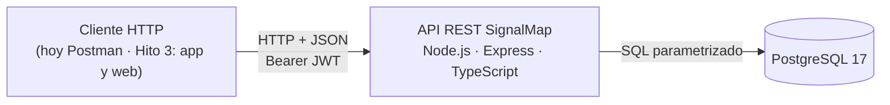
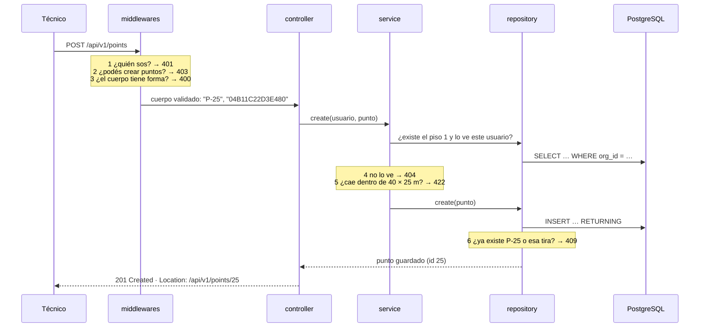
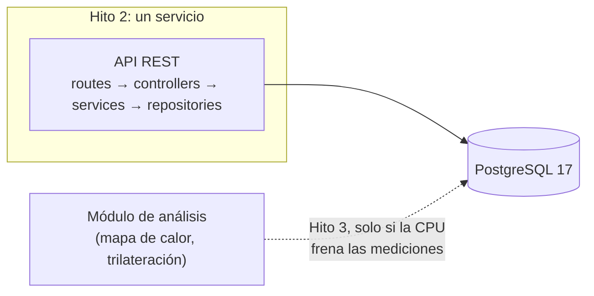
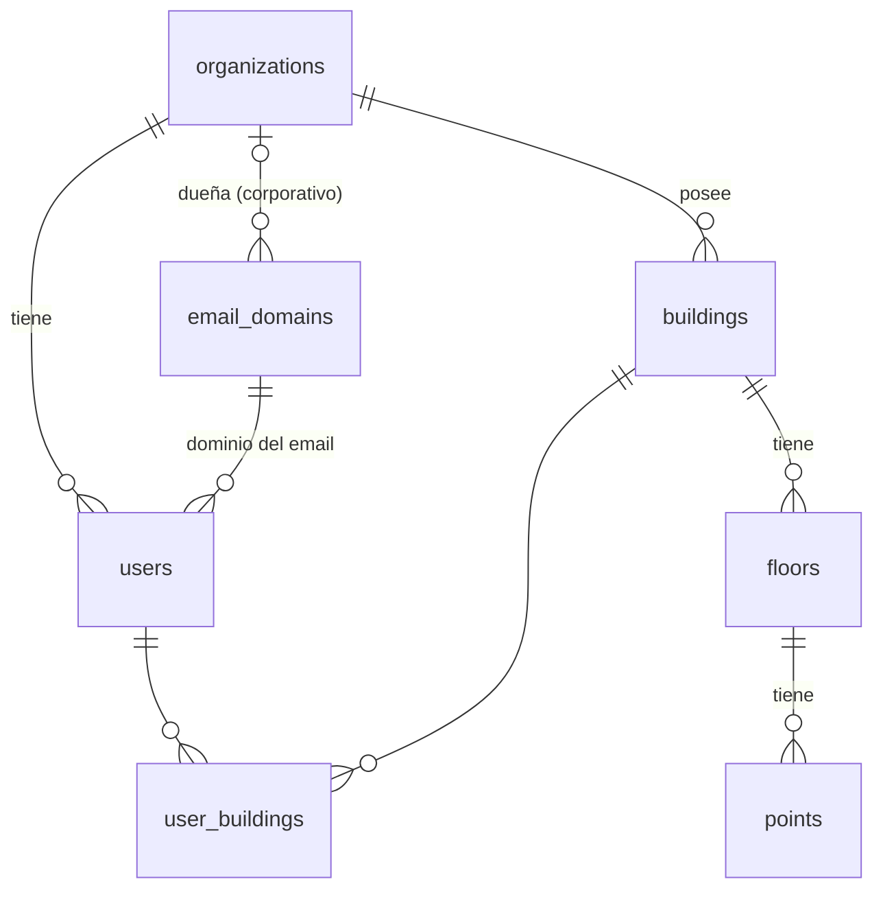
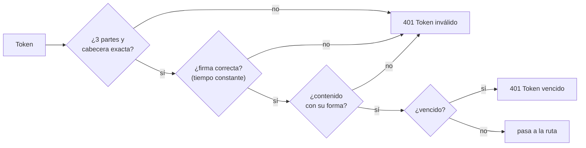

# SignalMap · Hito 2 — Motor back-end y API REST

**Documento técnico** · Universidad Mayor, Facultad de Ciencias, Ingeniería y Tecnología · Arquitectura de Desarrollo (Web y Móvil) · Docente: Carlos Mauricio Muñoz

**Equipo:** Maximiliano Alvarado (`Signali`) · Gabriel Díaz (`Gabo-collab`) · Santiago, noviembre de 2026

**Repositorio:** https://github.com/Signali/MapeoWifiSignal

## Resumen

SignalMap mide la señal WiFi en puntos fijos de un edificio, marcados con tiras NFC, para comprobar si un repetidor mejoró la cobertura. Este documento describe el servidor construido en el Hito 2: una API REST de 13 endpoints con CRUD completo de edificios y puntos de medición, lectura de pisos y autenticación con JWT para tres roles, sobre PostgreSQL 17.

Cuatro decisiones lo definen:

- **Monolito en capas** (sección 3). Un equipo de 2 personas y unos 24 puntos por piso no justifican servicios separados. Las reglas de cada capa se comprobaron con búsquedas en el código.
- **Contrato antes que código** (sección 4). La interfaz se acordó antes de programar. Cada error responde su código HTTP, nunca `200`, y un recurso de otra organización responde `404` para no revelar que existe.
- **La base garantiza lo que puede comprobar sola** (sección 5): duplicados, rangos y formatos. El servicio se ocupa de lo que necesita leer otra tabla o saber quién pregunta.
- **Credenciales fuera del repositorio y JWT propio** (sección 6): toda la configuración llega por variables de entorno, y la verificación del token se probó contra cada ataque conocido.

**Cómo se comprobó** (sección 8): 391 tests, uno por cada respuesta del contrato, corren en cada Pull Request contra un PostgreSQL 17 real. Las 86 fallas introducidas a propósito en reglas críticas fueron detectadas por los tests. El servicio queda listo para recibir peticiones en un tiempo de entre 0,4 y 1 s, según el estado del equipo (sección 3.4). Una prueba de carga mostró que la lista de puntos sostiene unas 880 peticiones por segundo sin errores y que el límite es el login, con unas 6 por segundo (sección 8.3). El uso de inteligencia artificial está declarado, con las partes en que se usó y cómo se verificó (sección 8.4).

**Respecto del Hito 1** (sección 2) se mantienen el stack y la arquitectura. Cambian el modelo de datos, el formato de errores y la renovación del token. La ingesta de mediciones, la app y PostGIS pasan al Hito 3.

---

## 1. Introducción y alcance

El informe del Hito 1 (Alvarado y Díaz, 2026) planteó el problema: las empresas que instalan o amplían su red WiFi no saben con certeza si la señal llega a cada puesto ni si el repetidor que agregan funciona. SignalMap lo resuelve con tiras NFC en puntos fijos del edificio, una app Android que mide la señal en esos puntos y una plataforma web que muestra el resultado antes y después de instalar el repetidor.

Este documento cubre **solo el servidor**: la API REST que esas dos aplicaciones van a usar, sus capas y su base de datos. En concreto, el Hito 2 entrega:

- **Edificios y puntos de medición** con alta, consulta, edición y baja; **pisos**, solo para consultar.
- **Login con JWT** y tres roles: `admin`, `tecnico` y `cliente`.
- **13 endpoints** bajo `/api/v1`, acordados en un contrato antes de programar.
- **PostgreSQL 17** con 7 tablas y un script que crea la base desde cero.
- Un servicio en **Node.js 26 + Express + TypeScript** que se levanta siguiendo el README.



**Cómo leer este documento.** Las secciones 3 a 6 siguen a una misma historia: un técnico que registra el punto P-25 en el piso 3 de la Torre Norte, y lo que le pasa a ese punto después. Cada sección explica una parte del servidor a través de esa historia. Las tablas de consulta (variables, campos, mensajes de error) están en los anexos, para que el cuerpo se pueda leer de corrido.

**Fuera de este hito:** campañas y mediciones, mapa de calor, comparación antes/después, trilateración, recomendación del repetidor, reporte PDF, app Android y web. Todo eso es del Hito 3 (sección 2).

---

## 2. Qué cambió desde el Hito 1

El Hito 1 fijó un plan; al construir el servidor, algunas piezas se mantuvieron, otras cambiaron y otras se movieron al Hito 3:

<div class="hitos">
  <div class="h"><span>Hito 1: el plan</span><span>Hito 2: lo construido</span><span>Hito 3</span></div>
  <div><span>Un solo back-end: Node · Express · TypeScript · Zod</span><span>Monolito en capas, mismo stack, con la API de edificios, pisos, puntos y login</span><span class="vacio">sigue igual</span></div>
  <div><span>PostgreSQL + PostGIS</span><span>PostgreSQL 17, con x e y en metros</span><span>PostGIS, solo si una consulta la necesita</span></div>
  <div><span>Ingesta de mediciones y app con NFC y WiFi</span><span class="vacio">se posterga</span><span>Mediciones, app y web</span></div>
</div>

### 2.1 Lo que se mantiene

La arquitectura y el stack siguen igual: un solo back-end para la app y la web, Node.js con Express y TypeScript, Zod para validar cada endpoint y PostgreSQL relacional con la jerarquía organización → edificio → piso → punto. También se mantienen los tres roles y el JWT, y el `nfc_uid` único por punto, que ahora es único en todo el sistema.

### 2.2 Lo que cambió

| El Hito 1 decía | El Hito 2 tiene | Por qué |
|---|---|---|
| 4 niveles: middlewares, rutas y controladores juntos, servicios, repositorios | 5 carpetas (`routes`, `controllers`, `services`, `repositories`, `middlewares`) más `schemas` | Separar ruta y controlador deja ver que el controlador no decide nada (sección 3.2) |
| Modelo de 9 entidades | 7 tablas: se suman `email_domains` y `user_buildings` | El email se guarda sin repetir el dominio, y el cliente ve solo los edificios que tiene asignados |
| Piso con «plano y dimensiones de grilla» | Piso con ancho y largo en metros, sin imagen | No hay subida de planos en este hito; sirve para rechazar un punto fuera del piso (`422`) |
| Punto con `x`, `y`, `nfc_uid` | Se suma `code` (`P-07`), único por piso; `nfc_uid` en hexadecimal y mayúsculas | Identificar el punto en terreno y que `04a2…` y `04A2…` cuenten como la misma tira |
| Errores con código propio (`404 TAG_UNKNOWN`) | Código HTTP + `{ "message": "..." }` | Simplificar: el código HTTP ya dice la clase de error. Queda abierto sumar un campo `code`, sin romper a quien solo lee `message` |
| Token vencido: `401` y renovación automática | `401` sin renovación; duración por rol (8, 10 y 2 h) | Autenticación mínima en este hito; la renovación pasa al Hito 3 |
| JWT, sin detalle | HS256 con `node:crypto`, sin librería | Cero dependencias en la pieza más sensible (sección 6.4) |
| `GET /points/by-tag/:nfcUid` y `POST /measurements` | Rutas bajo `/api/v1`, en `snake_case`; esas dos todavía no existen | Las usa la app al medir, que es del Hito 3 |

<p style="break-after: avoid"><b>Qué impacto tuvieron estos cambios:</b></p>

- **Para quien consume la API.** Hay menos que aprender: el código HTTP da la clase de error y `message` lo explica. A cambio, si una aplicación necesita distinguir dos errores con el mismo código, hoy solo puede leer el texto; por eso queda abierto sumar el campo `code`.
- **Para la app del Hito 3.** Al vencer el token recibe un `401` y el usuario vuelve a iniciar sesión, porque no hay renovación. La tira NFC se envía en hexadecimal y sin separadores: `04:A2:…` responde `400`.
- **Para los datos.** Un punto fuera del piso se rechaza antes de guardarse (`422`), y `p-25` y `P-25` cuentan como el mismo código. Como el piso todavía no tiene plano, ese tema vuelve a plantearse en el Hito 3.
- **Para el Hito 3.** Recibe lo que este hito no construyó: las rutas de medición, la app y la web, y la renovación del token.

### 2.3 Lo que se posterga, y cuándo vuelve

- **Ingesta de mediciones y app con NFC y WiFi**, que el Hito 1 ubicaba en este hito. Vuelven en el Hito 3, con su contrato acordado antes de programar, como se hizo ahora.
- **PostGIS**, que el Hito 1 declaraba «para implementar en el Hito 2». Ninguna consulta de este hito la necesita (el mismo Hito 1 reconocía que no es imprescindible con ~24 puntos por piso). Pasa al Hito 3, y solo si una consulta espacial la exige.
- **El volumen de planos en Docker.** Este hito no tiene planos ni Docker, pero el servicio ya está preparado: toda su configuración llega por variables de entorno, escucha en `0.0.0.0` y tiene `GET /health`.
- **La gestión de usuarios por el administrador** (`/admin/users`, en el mapa del producto). En este hito no existe: los 3 usuarios de prueba salen del seed.

---

## 3. Arquitectura: el viaje de una petición

En el piso 3 de la Torre Norte (40 × 25 m, con 24 tiras ya instaladas) el técnico pega una tira nueva junto a la sala de reuniones y la registra como el punto P-25: 30 m desde el borde izquierdo del plano y 12,5 m desde el borde superior. Hoy lo hace desde Postman; en el Hito 3 lo hará la app. Lo que viaja es esto:

```http
POST /api/v1/points
Authorization: Bearer eyJhbGciOi...
Content-Type: application/json

{ "floor_id": 1, "code": "p-25", "x": 30, "y": 12.5, "nfc_uid": "04b11c22d3e480" }
```

El código y la tira van en minúscula a propósito: así los escribió el técnico.

### 3.1 Seis preguntas antes de guardar un punto

El servidor es **un solo servicio** (unas 1.000 líneas de TypeScript en `backend/src/`) con una base PostgreSQL. Por dentro, la petición pasa por capas, y cada una hace una sola pregunta. Si la respuesta es «no», corta ahí con su código y las demás ni se enteran:



Con el P-25 todas las respuestas son «sí»: el token es válido, el técnico puede crear puntos, el cuerpo tiene forma y, de paso, `p-25` se normaliza a `P-25` y la tira a mayúsculas. El piso existe y es de su organización, 30 ≤ 40 y 12,5 ≤ 25, y no hay otro P-25. Pero si el técnico se hubiera equivocado y escrito `"x": 45`, la pregunta 5 cortaría con `422 "Las coordenadas quedan fuera del piso (40 x 25 m)"`, sin llegar a la base.

Primero se comprueba **quién** pide y después **qué** pide. Por eso un cliente que manda un cuerpo mal formado recibe `403` y no `400`: no tiene sentido explicarle el formato de algo que igual no puede hacer.

El controlador hace muy poco. Esta es su función entera (`controllers/points.ts`, sin las anotaciones de tipo):

```ts
export async function create(req, res) {
  const point = await pointsService.create(req.user!, req.body);
  res.status(201).location(`${req.baseUrl}/${point.id}`).json(point);
}
```

Dos líneas: pedirle al servicio que cree el punto y responder `201`. Ninguna decisión de negocio vive acá.

### 3.2 Cómo sabemos que las capas no son solo carpetas

Tener carpetas con nombres de capas no prueba nada. La prueba es que cada capa respete lo que **no** puede hacer:

| Capa | Hace | No puede |
|---|---|---|
| `routes/` + `middlewares/` | Ruta, token, rol, formato (Zod) | Tener reglas de negocio |
| `controllers/` | Leer la petición y elegir el código de éxito | Decidir nada ni tocar la base |
| `services/` | Reglas de negocio: qué ve cada rol, el punto dentro del piso | Conocer HTTP o escribir SQL |
| `repositories/` | SQL con parámetros | Decidir permisos |

Esas prohibiciones se comprobaron con búsquedas en el código. Estas son las que se corrieron (resumidas) y lo que encontraron:

```console
# desde backend/src
$ grep -l "from 'express'"  services/*.ts                    # services que conocen HTTP
(ninguno)
$ grep -l "res\.\|\.status("  services/*.ts                  # services que arman respuestas
(ninguno)
$ grep -l "repositories/"   controllers/*.ts schemas/*.ts   # controllers o schemas que tocan la base
(ninguno)
$ grep -rl "SELECT \|INSERT \|UPDATE \|DELETE FROM" .   | grep -v repositories/
(ninguno)                                                    # todo el SQL vive en repositories/
```

Falta una pieza para que ningún error se escape con `200`: los servicios lanzan errores con un tipo de negocio (`not_found`, `domain_rule`, `conflict`…) y **un único archivo**, `middlewares/error-handler.ts`, los traduce a código HTTP. No hay otro camino para responder un error.

### 3.3 ¿Por qué un solo servicio?

Se eligió un **monolito en capas**. Para entender el costo de cada opción se consultó a Fowler (2015), quien observa que los sistemas de microservicios exitosos casi siempre empezaron como un monolito que se dividió después, cuando los límites entre servicios ya estaban claros. La decisión, de todos modos, sale de los números de este proyecto:

- **Somos 2 personas, con un semestre.** Cada servicio extra suma despliegue, configuración y depuración para las mismas dos personas.
- **La carga es chica.** Hay unos 24 puntos por piso, el técnico mide uno a la vez y Android permite 4 escaneos WiFi cada 2 minutos (Alvarado y Díaz, 2026, §8.2). Ninguna parte necesita crecer por separado.
- **Operarlo es simple.** Hoy es un proceso y una base; en el Hito 3, dos contenedores. Hay un solo `GET /health` que vigilar.
- **Los datos son una cadena.** Organización → edificio → piso → punto, y en el Hito 3 campaña → medición. Repartirlos en bases distintas obligaría a cuidar esa integridad a mano, que es justo lo que PostgreSQL hace solo.

El costo asumido es que todo escala junto y un error grave puede tumbar el servicio entero. Y la decisión tiene fecha de revisión: si el análisis del Hito 3 (mapa de calor, trilateración) llegara a consumir tanta CPU que frenara el registro de mediciones, eso sería lo primero en separarse, porque solo lee datos.



### 3.4 ¿Cuánto tarda en arrancar?

El servicio queda listo para recibir peticiones en **entre 0,4 y 1 s**, según el estado del equipo. Se midió desde que se lanza el proceso hasta que `GET /health` responde `200`, en series de 10 arranques en Pc-Portatil (Intel Core i5-13420H, 24 GB de RAM, Windows 11, Node 26.13.0). Cualquiera puede repetirlo con `npm run startup-time` en `backend/`.

<div class="bars" aria-label="Mediana de 10 arranques por serie">
  <p>Mediana de 10 arranques (enchufado y a batería: la serie central de tres)</p>
  <div><span>Serie 1</span><i style="width:68.5%"></i><b>753 ms</b></div>
  <div><span>Serie 2</span><i style="width:87.4%"></i><b>961 ms</b></div>
  <div><span>Serie 3</span><i style="width:84.7%"></i><b>932 ms</b></div>
  <div><span>Serie 4</span><i style="width:94.9%"></i><b>1.044 ms</b></div>
  <div><span>A batería</span><i style="width:51.8%"></i><b>570 ms</b></div>
  <div><span>Enchufado</span><i style="width:35.2%"></i><b>387 ms</b></div>
  <div><span>Solo Node</span><i style="width:5.1%"></i><b>56 ms</b></div>
</div>

La variación no viene del método. Las series 1 a 4 son del 6 de noviembre y no se registró si el equipo estaba enchufado; las series 2 a 4 se corrieron seguidas y alternando dos formas de consultar `/health`, y dieron valores parecidos. El 9 de noviembre se repitió con tres series por estado: enchufado dio medianas de 387 y 388 ms, y a batería, de 560 a 592 ms. La energía explica una parte, pero ni a batería se volvió a llegar a las cifras del 6 de noviembre, y el resto de la diferencia no se pudo explicar. `/health` no consulta la base, así que el número no incluye la conexión a PostgreSQL.

¿En qué se va ese tiempo? El desglose es del 6 de noviembre, así que corresponde a esos tiempos más lentos. Cargando cada pieza por separado (3 corridas) se explican unos 0,67 s; el resto, hasta que `/health` responde, no se desglosó:

<div class="stack" aria-label="Desglose del arranque">
  <div>
    <i class="s1" style="flex:56"><b>Node</b><small>56 ms</small></i>
    <i class="s2" style="flex:170"><b>Express</b><small>170 ms</small></i>
    <i class="s3" style="flex:155"><b>Zod</b><small>155 ms</small></i>
    <i class="s4" style="flex:55"><b>pg</b><small>55 ms</small></i>
    <i class="s5" style="flex:235"><b>resto de src/</b><small>235 ms</small></i>
  </div>
</div>

El tramo más largo, «resto de `src/`», incluye el hash ficticio de bcrypt que usa el login (sección 6.3). Ese día costaba unos 100 ms; el 9 de noviembre, con 10 procesos nuevos, la mediana fue de 60 ms enchufado y 92 ms a batería.

## 4. Diseño de la API REST: la vida de un punto

El P-25 ya existe (sección 3). La demostración sigue su vida completa: al día siguiente el técnico se da cuenta de que lo midió mal y corrige la posición; después el administrador decide que ese punto sobra y lo borra; por último, alguien lo vuelve a pedir. Son tres peticiones más (en la demostración en vivo, las cuatro se hacen con la sesión del administrador), y cada una muestra una decisión del contrato, que se escribió y acordó entre los dos integrantes **antes de programar** (`docs/api-contract.md`, 2026-11-04):

```http
PATCH /api/v1/points/25          { "x": 13, "y": 8.5 }
→ 200 OK                         { "id": 25, "floor_id": 1, "code": "P-25", "x": 13, "y": 8.5, "nfc_uid": "04B11C22D3E480" }

DELETE /api/v1/points/25
→ 204 No Content                 (sin cuerpo)

GET /api/v1/points/25
→ 404 Not Found                  { "message": "Punto no encontrado" }
```

### 4.1 Lo que esas cuatro peticiones enseñan

- **El verbo dice qué se hace y la URL, sobre qué.** Los recursos son sustantivos en plural (`/buildings`, `/points`) y cada uno tiene una sola dirección: `/points/25`, nunca `/floors/1/points/25`. Para listar se filtra: `/points?floor_id=1`.
- **Crear devuelve dónde quedó lo creado.** El `POST` respondió `201` con la cabecera `Location: /api/v1/points/25`, que es lo que define HTTP para ese código: RFC 9110 (Fielding et al., 2022, §15.3.2).
- **Corregir no obliga a reenviar todo.** El técnico mandó solo `x` e `y`: se actualiza únicamente con `PATCH`, que es una modificación parcial según RFC 5789 (Dusseault y Snell, 2010). No hay `PUT`.
- **Borrar no devuelve nada** (`204`), y el `404` del final demuestra que el borrado fue real.
- **Nombres en `snake_case` y versión en la ruta.** `snake_case` en cuerpo, respuesta y parámetros (`floor_id`, `nfc_uid`), y la versión va en la ruta (`/api/v1`): un cambio incompatible, como pasar los ids a UUID, saldría como `v2` sin romper a la app.
- **Los ids son opacos.** Son enteros, pero el cliente no calcula ni ordena por ellos.
- **Un campo desconocido es un error.** Si la ruta no lo conoce (un `flor_id` mal escrito), responde `400`.
- **Cada consulta se filtra por organización.** Toda consulta se filtra por la organización del token; quien llama nunca envía su `org_id`, así que no puede pedir datos ajenos aunque adivine un id.

Las listas devuelven un arreglo simple, ordenado por `id` y sin paginación, porque hay unos 24 puntos por piso. La paginación queda para el Hito 3 (sección 8.2).

### 4.2 Los 13 endpoints

| # | Verbo | Ruta | Roles | Parámetros | Éxito | Errores |
|---|---|---|---|---|---|---|
| 1 | `GET` | `/health` | público | — | `200` | — |
| 2 | `POST` | `/api/v1/auth/login` | público | cuerpo: `email`, `password` | `200` | `400` `401` |
| 3 | `GET` | `/api/v1/buildings` | todos | — | `200` | `400` `401` |
| 4 | `GET` | `/api/v1/buildings/:id` | todos | ruta: `id` | `200` | `400` `401` `404` |
| 5 | `POST` | `/api/v1/buildings` | `admin` | cuerpo: `name` | `201` + `Location` | `400` `401` `403` `409` |
| 6 | `PATCH` | `/api/v1/buildings/:id` | `admin` | ruta: `id` · cuerpo: `name` | `200` | `400` `401` `403` `404` `409` |
| 7 | `DELETE` | `/api/v1/buildings/:id` | `admin` | ruta: `id` | `204` | `400` `401` `403` `404` `409` |
| 8 | `GET` | `/api/v1/floors` | todos | consulta: `building_id` (obligatorio) | `200` | `400` `401` `404` |
| 9 | `GET` | `/api/v1/points` | todos | consulta: `floor_id` (obligatorio) | `200` | `400` `401` `404` |
| 10 | `GET` | `/api/v1/points/:id` | todos | ruta: `id` | `200` | `400` `401` `404` |
| 11 | `POST` | `/api/v1/points` | `admin` `tecnico` | cuerpo: `floor_id`, `code`, `x`, `y`, `nfc_uid` | `201` + `Location` | `400` `401` `403` `404` `409` `422` |
| 12 | `PATCH` | `/api/v1/points/:id` | `admin` `tecnico` | ruta: `id` · cuerpo: al menos uno de `code`, `x`, `y`, `nfc_uid` | `200` | `400` `401` `403` `404` `409` `422` |
| 13 | `DELETE` | `/api/v1/points/:id` | `admin` | ruta: `id` | `204` | `400` `401` `403` `404` |

Cinco endpoints reciben cuerpo; este es un ejemplo de cada uno:

```http
POST /api/v1/auth/login
{ "email": "admin@demo.cl", "password": "<clave del .env>" }

POST /api/v1/buildings
{ "name": "  bodega   sur " }

PATCH /api/v1/buildings/1
{ "name": "Torre Norte (remodelada)" }

POST /api/v1/points
{ "floor_id": 1, "code": "P-25", "x": 30, "y": 12.5, "nfc_uid": "04B11C22D3E480" }

PATCH /api/v1/points/25
{ "x": 13, "y": 8.5 }
```

Las respuestas de ejemplo de cada endpoint y todos sus casos de error están en el contrato (Anexo A).

### 4.3 ¿Y si algo sale mal?

La historia del P-25 salió bien. Pero cada error posible tiene su código y su mensaje, y la forma más clara de verlos es preguntarse qué pasaría si:

```http
# ...el técnico escribe la coordenada con letras?
POST /api/v1/points   { "floor_id": 1, "code": "P-25", "x": "doce", "y": 12.5, "nfc_uid": "04B11C22D3E480" }
→ 400  { "message": "x debe ser un número con hasta 2 decimales" }

# ...el número es válido pero no cabe en un piso de 40 m?
POST /api/v1/points   { ..., "x": 45, ... }
→ 422  { "message": "Las coordenadas quedan fuera del piso (40 x 25 m)" }

# ...esa tira ya está pegada en otro punto?
→ 409  { "message": "La tira NFC ya está asociada a otro punto" }

# ...lo intenta un cliente, que solo puede mirar?
→ 403  { "message": "No tiene permiso para esta acción" }

# ...nadie inició sesión?
→ 401  { "message": "Token requerido" }        WWW-Authenticate: Bearer

# ...alguien pide un punto de otra empresa?
→ 404  { "message": "Punto no encontrado" }
```

Todos los errores tienen el mismo cuerpo, `{ "message": "..." }`, y **ninguno responde `200`**. Detrás de esas respuestas hay tres decisiones:

- **Lo ajeno responde `404`.** El punto de otra empresa responde exactamente lo mismo que uno que nunca existió. Así no se revela que existe, algo que HTTP permite expresamente (Fielding et al., 2022, §15.5.4). El `403` queda solo para «lo ves, pero tu rol no puede tocarlo».
- **`400` no es lo mismo que `422`.** `"doce"` no es un número: es un error de formato. `45` sí es un número válido, pero rompe una regla del negocio: «Unprocessable Content» (Fielding et al., 2022, §15.5.21).
- **Todo `401` dice cómo autenticarse**, con la cabecera `WWW-Authenticate: Bearer`, que HTTP exige (Fielding et al., 2022, §15.5.2; RFC 6750: Jones y Hardt, 2012, §3).

Hay tres más, comunes a todas las rutas: `413` si el cuerpo pasa de 100 kB, `415` si llega en una codificación no soportada y `500` genérico ante un error inesperado, con el detalle solo en el log. El orden en que se revisan (primero quién pide, después qué pide) está en la sección 3.1.

### 4.4 Quién puede hacer qué

| Acción | `admin` | `tecnico` | `cliente` |
|---|:-:|:-:|:-:|
| Ver edificios, pisos y puntos | toda su organización | toda su organización | solo sus edificios asignados |
| Crear, editar y borrar edificios | sí | `403` | `403` |
| Crear y editar puntos | sí | sí | `403` |
| Borrar puntos | sí | `403` | `403` |

El técnico crea y corrige puntos porque es quien está en terreno con las tiras (Alvarado y Díaz, 2026, §2.1). Borrar es irreversible (no hay papelera), así que queda para el administrador. Los edificios asignados a un cliente **no viajan en el token**: se consultan en cada petición, así que un cambio de asignación aplica de inmediato.

## 5. Datos y persistencia: dónde vive el P-25

El `INSERT` del final de la sección 3 dejó al P-25 en la tabla `points` de PostgreSQL 17. No en memoria ni en un archivo: si el servicio se reinicia, el punto sigue ahí. El acceso es con el driver `pg` y SQL escrito a mano, sin ORM (la comparación está en la sección 7).

### 5.1 El modelo



El P-25 cuelga de una cadena: su piso (el piso 3), el edificio de ese piso (la Torre Norte) y la organización dueña del edificio. Solo `users`, `buildings` y `email_domains` tienen `org_id`; pisos y puntos llegan a su organización siguiendo esa cadena de claves foráneas. Por eso no hay forma de que un punto quede en una organización distinta de la de su edificio. Las otras dos tablas resuelven problemas concretos: `email_domains` guarda cada dominio una sola vez y distingue los corporativos de los personales, y `user_buildings` dice qué edificios ve cada cliente. El detalle de las 7 tablas está en el Anexo B.

### 5.2 Quién cuida cada regla

La regla de fondo es que **la base garantiza todo lo que puede comprobar sola**, para que ningún camino (la API, el seed o un error de programación) deje datos inválidos. El servicio se ocupa de lo que necesita leer otra tabla o saber quién pregunta:


<div class="split">
  <div><p>La base lo impide sola</p><ul>
    <li><code>UNIQUE</code>: nombre de edificio por organización, <code>code</code> por piso, <code>nfc_uid</code> en todo el sistema → <code>409</code></li>
    <li><code>CHECK</code>: medidas mayores que 0, coordenadas desde 0, rol válido, <code>nfc_uid</code> en mayúsculas, emails en minúsculas</li>
  </ul></div>
  <div><p>El servicio lo decide</p><ul>
    <li>Que el punto caiga dentro del piso, porque las medidas están en otra tabla → <code>422</code></li>
    <li>Que cada uno vea solo su organización y, el cliente, solo lo asignado → <code>404</code></li>
    <li>Más de 2 decimales (Zod), porque la base redondearía en silencio → <code>400</code></li>
  </ul></div>
</div>

Una regla está en los dos lados a propósito: el servicio pasa el `nfc_uid` a mayúsculas, y la base rechaza cualquiera que no lo esté. Además, editar y borrar filtran por `id` **y** organización en la misma sentencia, y miran cuántas filas tocaron. Si fueron cero, el servicio responde `404`. Como la pertenencia se comprueba en la misma sentencia que escribe, no queda una ventana entre comprobar y escribir. (Para el `422` el servicio sí lee antes las medidas del piso, pero los pisos no se modifican por la API.)

### 5.3 Borrar

Toda la jerarquía usa `ON DELETE RESTRICT`: no se borra un edificio con pisos ni un piso con puntos. Por la API, intentar borrar la Torre Norte responde `409`. No hay cascada, así que borrar un edificio nunca se lleva sus pisos y puntos sin aviso. La única excepción es `user_buildings`, con `CASCADE`: es solo un vínculo de asignación y no debe impedir borrar un edificio vacío.

### 5.4 Números exactos

Las coordenadas del P-25 (30 y 12,5) y las medidas del piso son `numeric(7,2)`: exactas al centímetro y hasta 99.999,99 m. El driver `pg` entrega `numeric` como texto (`"12.50"`), pero la API debe responder números (`12.5`). La conversión vive en **una sola línea** de `repositories/db.ts`:

```ts
pg.types.setTypeParser(pg.types.builtins.NUMERIC, (value) => Number(value));
```

Un test recorre **todas** las columnas `numeric` del esquema, leídas de `information_schema`, y comprueba que llegan como número. Si mañana se agrega una columna `numeric`, queda cubierta sin tocar el test.

### 5.5 Consultas seguras

Esta es la consulta que guardó al P-25 (`repositories/points.ts`):

```ts
const { rows } = await query<Point>(
  `INSERT INTO points (floor_id, code, x, y, nfc_uid) VALUES ($1, $2, $3, $4, $5)
   RETURNING id, floor_id, code, x, y, nfc_uid`,
  [point.floor_id, point.code, point.x, point.y, point.nfc_uid],
);
```

Los valores viajan siempre como parámetros (`$1`, `$2`…), nunca pegados al texto del SQL, así que ningún valor puede cambiar la consulta (inyección SQL). En todo el código, lo único que se inserta en el texto de una consulta son constantes del propio código, como la lista de columnas o el filtro de organización. Las columnas se nombran una por una: ninguna consulta usa `SELECT *`, y ninguna respuesta de la API incluye `org_id`.

### 5.6 Crear la base desde cero

Cualquiera puede recrear la base de la demostración con dos comandos (salida resumida):

```console
$ psql -h localhost -U signalmap_user -d signalmap -v ON_ERROR_STOP=1 -f db/schema.sql
BEGIN
CREATE TABLE            (7 veces, una por tabla)
CREATE INDEX
COMMIT
$ npm run seed
Seed cargado en la base "signalmap".
```

`schema.sql` crea las 7 tablas en una sola transacción: o se crean todas o ninguna, y si ya existen, falla sin tocar nada. No crea la base ni el rol, así lo puede ejecutar tal cual la imagen oficial de PostgreSQL en el Hito 3. `npm run seed` vacía las tablas y carga los datos de la historia: 1 organización, 2 edificios, el piso 3 de 40 × 25 m y sus 24 puntos (el `P-07` es siempre el id 7). También crea los 3 usuarios de prueba con las claves del `.env`, hasheadas con bcrypt. Se niega a correr con `NODE_ENV=production`. Los pasos para crear el rol y las bases están en el Anexo C.

## 6. Configuración, credenciales y seguridad

### 6.1 Toda la configuración llega del entorno

El código no tiene claves, hosts ni puertos escritos: todo llega por variables de entorno. En desarrollo se leen de un `.env` en la raíz y, si no existe (como pasará en Docker), del entorno del proceso. `.env.example` lista las 15 variables con valores de ejemplo, y el Anexo D explica cada una.

Al arrancar, `config.ts` valida todo con Zod. Si algo falta o rompe su regla, el servicio **no arranca** y dice qué está mal, en vez de fallar más tarde con un error confuso. Esto es lo que se ve al arrancar con un `JWT_SECRET` demasiado corto (se omite la traza):

```console
$ JWT_SECRET=corto node src/server.ts
Error: Configuración inválida (revisar .env contra .env.example):
✖ debe tener al menos 32 caracteres
  → at JWT_SECRET
```

El mínimo viene de RFC 7518 (Jones, 2015, §3.2): HS256 exige una clave de al menos 256 bits, es decir 32 bytes. El README indica generarla al azar (32 bytes aleatorios en base64url, 43 caracteres). El valor de ejemplo también se rechaza, porque es público: con él, cualquiera que lea el repositorio podría firmar tokens.

### 6.2 Credenciales fuera del repositorio

`.gitignore` excluye `.env` y cualquier `.env.*` salvo la plantilla, además de `*.pem`, `*.key` y el environment de Postman con la clave real. Para comprobar que nunca se subió uno, se revisó el historial completo de git, todas las ramas:

```console
$ git log --all --name-only --format= | grep -E '(^|/)\.env' | sort -u
.env.example
```

El único archivo que pasó por el historial es la plantilla. Cada equipo crea su `.env` y genera su propio `JWT_SECRET`, y las claves no se comparten por chat ni por correo. La regla del equipo, si una credencial llegara a un commit, es **rotarla** (cambiarla por una nueva): borrar el archivo no alcanza, porque el historial queda visible. Las contraseñas existen solo como hash bcrypt (costo 10); el seed las toma del `.env`, así que ni las claves ni sus hashes están en el repositorio.

### 6.3 Login

`POST /auth/login` responde el mismo `401 "Credenciales inválidas"` si el email no existe y si la clave es incorrecta. Pero un mensaje igual no alcanza: si el email no existe y el servidor contesta al instante, la rapidez lo delata. Por eso, cuando el email no existe, igual se ejecuta bcrypt contra un hash ficticio. Ese hash se calcula una vez al arrancar, entre 60 y 100 ms según el estado del equipo (sección 3.4), y un test comprueba que bcrypt corre en los dos casos.

### 6.4 JWT propio

El token se firma y se verifica con `node:crypto` (HMAC-SHA256), sin librería, para que la pieza más sensible del servicio no sume dependencias. Un token tiene tres partes separadas por puntos, y lleva solo lo necesario:

```text
eyJhbGciOiJIUzI1NiIsInR5cCI6IkpXVCJ9 . eyJzdWIiOi4uLn0 . 3kR...firma
└───────── cabecera ──────────────┘   └── contenido ─┘   └ firma ┘

cabecera:  { "alg": "HS256", "typ": "JWT" }
contenido: { "sub": "<id del usuario>", "org_id": 1, "role": "tecnico", "exp": <vencimiento> }
```

El `sub` va como texto, como pide RFC 7519 (Jones et al., 2015, §4.1.2). El costo de no usar una librería es que la verificación queda en nuestras manos, y por eso sigue lo que recomienda RFC 8725 (Sheffer et al., 2020, §3.1): **aceptar solo el algoritmo que uno espera**. El servicio compara la cabecera con la única que emite y rechaza cualquier otra sin interpretarla. Además, revisa siempre en el mismo orden:



La firma se compara en tiempo constante, para que el tiempo de respuesta no dé pistas. Y como se revisa antes que el vencimiento, un token falso nunca recibe «vencido»: no se revela nada de él. Cada ataque conocido tiene su test, y todos terminan en `401`, nunca en `500`:

- `alg: "none"`, con y sin firma, el ataque clásico (Sheffer et al., 2020, §2.1);
- `RS256` (confusión de algoritmo) y `HS512` firmado con el secreto real;
- una cabecera con campos de más (`kid`);
- una firma alterada, con caracteres extra o fuera de base64url;
- un `cliente` que se cambia a `admin` en el contenido y conserva la firma original;
- un token firmado con otro secreto, uno vencido y uno que vence justo ahora;
- y 15 tokens deformes: con una, dos o cuatro partes, contenido que no es JSON, sin `role` o sin `exp`, con `sub` numérico o con campos extra.

### 6.5 Otras defensas

Un cuerpo de más de 100 kB se corta con `413` antes de procesarlo (`express.json()`), y un error inesperado responde un `500` genérico, con el detalle solo en el log (`middlewares/error-handler.ts`). Lo que todavía no está (límite de intentos de login, cabeceras de seguridad, revocar y renovar el token) figura con su plan en la sección 8.2.

### 6.6 Portabilidad

El servicio se levanta en otro equipo siguiendo solo el README, en cinco pasos (Anexo C). Escucha en `0.0.0.0` y expone `GET /health`, que es lo que necesitará el contenedor del Hito 3.

**El ensayo en otro equipo.** Gabriel lo hizo en su PC con Windows, siguiendo solo los README. Levantó todo: el seed, `GET /health`, `npm run typecheck`, los 388 tests en verde y las 4 peticiones de la demo en Postman (`201`, `200`, `204` y `404`). Pero faltaban pasos propios de Windows que los README no traían. El más importante: sin fijar `PGCLIENTENCODING=UTF8`, `psql -f db/schema.sql` falla por codificación. Esos pasos ya están en los README.

Para producción (Hito 3), el plan está escrito en `backend/README.md`: pasar `JWT_SECRET` como secreto de Docker (un archivo en memoria, que no aparece en `docker inspect`) y rotarlo ante cualquier sospecha, lo que invalida todos los tokens emitidos.

## 7. Decisiones de tecnología

Todas las decisiones se tomaron con los mismos criterios: un equipo de 2 personas y un semestre, el mismo lenguaje que tendrá la web (TypeScript), capas que se puedan defender, que **los dos integrantes** puedan explicar cada parte del código y una carga baja (~24 puntos por piso).

### 7.1 Framework: Express

El Hito 1 comparó Express con Spring Boot. Al empezar el Hito 2 se amplió la comparación, sin cambiar la decisión:

| Opción | Qué ofrece | Por qué no en este proyecto |
|---|---|---|
| **Express 5 (elegido)** | Rutas y middlewares, sin estructura impuesta. Muy documentado; se integra directo con Zod y Supertest | — |
| Fastify | Más velocidad y validación propia con JSON Schema | La velocidad no se nota con esta carga, y suma un sistema de plugins por aprender |
| NestJS | Estructura impuesta: módulos, decoradores, inyección de dependencias | Para 2 personas y 2 recursos, la ceremonia cuesta más de lo que ordena |
| Hono | Muy liviano y portable entre entornos | Su fuerte son las funciones en el borde de la red (*edge*), que no usamos |
| Spring Boot | Estructura y seguridad maduras | Otro lenguaje: no comparte tipos con la web en TypeScript |

El costo asumido es que Express no impone capas, así que la separación es una disciplina nuestra. Se sostiene con reglas que se comprueban en el código (sección 3.2). Si el equipo o el proyecto crecieran, el candidato para revisar la decisión sería NestJS.

### 7.2 El resto del stack, decisión por decisión

**TypeScript sin compilar**, en vez de compilar a `dist/`. Node 26 ejecuta los `.ts` directamente y `tsc` solo revisa tipos (`npm run typecheck`), así que lo que corre es exactamente lo que está en el repositorio. El costo: solo se puede usar sintaxis que Node sabe borrar (nada de `enum` ni `namespace`) y el proyecto depende de Node 26. Pasar a compilar en el Hito 3 está preparado en `tsconfig.json`.

**Zod**, en vez de validar a mano en cada controlador. Un schema por endpoint concentra el formato, los mensajes y la normalización (el `p-25` → `P-25` de la sección 3), y de ese schema salen los tipos de TypeScript. Cuesta una dependencia más, que tardó ~155 ms en cargar en el desglose de la sección 3.4.

**`pg` con SQL escrito a mano**, en vez de Prisma (un ORM) o Knex y Kysely (constructores de consultas). Las consultas quedan visibles en `repositories/`, que es justamente la evidencia de las capas (sección 5.5). Prisma esconde el SQL y pide su propio esquema, que duplicaría `db/schema.sql`; Knex o Kysely serían una dependencia más para 2 recursos. El costo es mapear filas a objetos y declarar los tipos a mano.

**PostgreSQL 17 instalado en cada PC**, en vez de Docker Desktop o una base en la nube (Neon, Supabase). Docker Desktop en Windows necesita WSL2, que en Pc-Portatil no está instalado (y la virtualización figura desactivada): un riesgo para la demostración en vivo. La nube depende de internet en la sala, y su cadena de conexión sería una credencial real. El costo es instalar PostgreSQL en cada equipo; Docker llega en el Hito 3.

**`bcryptjs`**, bcrypt escrito en JavaScript, en vez de `bcrypt` nativo. No compila nada al instalarse, así que funciona igual en cualquier PC y en Docker. Cuesta entre 60 y 100 ms por hash con costo 10, según el estado del equipo (sección 3.4).

El **JWT propio**, frente a una librería como `jsonwebtoken`, se justifica en la sección 6.4.

### 7.3 Tests: Vitest

Vitest se eligió al armar el esqueleto del servicio, sin compararlo en ese momento con su alternativa principal, Jest. La comparación se hizo al escribir este documento, con el criterio que más pesa acá: **correr el código lo más parecido posible al servicio, y sin configuración extra**. El servicio es TypeScript con módulos ESM ejecutado directo por Node.

Vitest trae TypeScript y ESM sin configurar (Vitest, s. f.), y esta es toda su configuración en el proyecto:

```ts
import { defineConfig } from 'vitest/config';

export default defineConfig({
  test: {
    // Antes de los tests se resiembra signalmap_test: siempre parten del mismo estado.
    globalSetup: ['tests/global-setup.ts'],
  },
});
```

Con Jest, el TypeScript necesita Babel o `ts-jest`, y con Babel los tests ni siquiera revisan tipos (Jest, s. f.-b). Su soporte de ESM es **experimental** y exige lanzar Node con una bandera, como indica su propia documentación (Jest, s. f.-a):

```console
$ node --experimental-vm-modules node_modules/jest/bin/jest.js
```

La comparación confirmó la elección, con un matiz: ninguno de los dos corre el código exactamente como Node. Vitest también transforma el TypeScript por su cuenta y aceptaría un `enum` que `npm start` rechaza. Esa diferencia la cubre `npm run typecheck`, que corre en el CI y marca esa sintaxis (`erasableSyntaxOnly` en `tsconfig.json`).

## 8. Calidad, riesgos y deuda técnica

### 8.1 Cómo se comprueba que funciona

<div class="kpis">
  <div><b>391</b><span>tests, uno por cada respuesta del contrato</span></div>
  <div><b>86 / 86</b><span>fallas introducidas a propósito, detectadas</span></div>
  <div><b>0</b><span>hallazgos de seguridad de confianza alta</span></div>
  <div><b>0,4 a 1 s</b><span>en quedar listo para recibir peticiones, según el estado del equipo</span></div>
</div>

**Un test por respuesta del contrato.** Cada endpoint tiene su caso feliz y uno por cada error que declara (`400`, `401`, `403`, `404`, `409`, `422`), probado con tokens de los 3 roles, con una segunda organización y con un cliente sin asignaciones. La mayoría son tests de integración con Supertest: hacen una petición HTTP real al servicio, que trabaja contra una base PostgreSQL de prueba. En el CI pasan los 391. En Windows pasan 388, porque los 3 del apagado ordenado solo corren en Linux: ahí una señal enviada por código termina el proceso sin pasar por su manejador, así que en Windows se prueba a mano con `Ctrl+C`.

**Integración continua.** En cada Pull Request, GitHub Actions corre `npm run typecheck` y todos los tests contra un PostgreSQL 17 real. `main` está protegida: nada entra sin el CI en verde y sin pasar por un Pull Request, tampoco para el administrador.

**Romper a propósito para probar los tests.** Si un test no falla cuando la regla que cuida está rota, ese test no sirve. Por eso se rompió a mano, una por una, cada regla crítica: quitar el filtro de organización, invertir el orden `403`/`400`, saltear una normalización… Se corrió la suite y se restauró el archivo. Fueron 86 mutaciones (25 en edificios y 61 en puntos) y las 86 hicieron fallar al menos un test. En el camino aparecieron huecos reales: el orden `403` antes de `400` solo se probaba en `POST`, y con la regla rota en `PATCH` y `DELETE` la suite seguía en verde. Se sumaron esos dos tests.

**Revisión de código y de seguridad al cerrar cada recurso**, con revisión automatizada (`/code-review` y `/security-review`) y una decisión del equipo sobre cada hallazgo. En seguridad hubo cero hallazgos de confianza alta, en autenticación, edificios y puntos. En código hubo 26: 16 se corrigieron y los otros 10 se resolvieron con el equipo, se documentaron o se descartaron, cada uno con su motivo.

Y ninguna entrada del cliente provoca un `500`: tokens deformes, JSON roto, escapes inválidos en la URL y cuerpos enormes responden siempre `4xx`, con su mensaje.

### 8.2 Lo que falta, a conciencia

**Pasa al Hito 3:**

- **Límite de intentos de login**, porque hoy una clave débil se podría adivinar por fuerza bruta.
- **Cabeceras de seguridad** (`helmet`) y **CORS**, junto con la web: sin CORS, la web, que corre en otro origen, no podría llamar a la API (la app Android no lo necesita).
- **Renovar el token.** Hoy, uno robado sirve hasta que vence (2 a 10 h según el rol); ante una sospecha, se rota `JWT_SECRET` (sección 6.6).
- **Paginación.** Las listas no la tienen (sección 4.1). Agregarla cuando la app y la web ya usen el formato actual sería un cambio incompatible (`v2`), así que se define al empezar el Hito 3.
- **PostGIS**, solo si una consulta espacial la necesita (sección 2.3), y **Docker**, para el que el servicio ya está preparado (sección 6.6).

**Documentado, sin efecto hoy:** bcrypt solo considera los primeros 72 bytes de una clave, algo que no afecta a claves normales.

### 8.3 ¿Y bajo carga?

La sección 3.3 sostiene que la carga es chica, pero eso era una estimación. Para tener un número se lanzaron peticiones en paralelo con `autocannon` (versión 8) contra el servicio corriendo, con la base cargada con el seed (24 puntos en el piso). Fue en Pc-Portatil, con el cliente y el servidor en la **misma máquina** (compiten por la CPU), **una corrida de 10 segundos por escenario**, sin repetir, y **solo con lecturas y login**: no se escribió nada. La herramienta no está en el repositorio. Sirve para ubicar el orden de magnitud, no como prueba de producción.

<div class="bars" aria-label="Peticiones por segundo según el endpoint">
  <p>Peticiones por segundo (cada una con 10 o 50 conexiones simultáneas)</p>
  <div><span>/health</span><i style="width:100%"></i><b>6.231</b></div>
  <div><span>/buildings</span><i style="width:28.3%"></i><b>1.761</b></div>
  <div><span>/points/:id</span><i style="width:20.3%"></i><b>1.267</b></div>
  <div><span>/points</span><i style="width:14.4%"></i><b>898</b></div>
  <div><span>login</span><i style="width:0.5%"></i><b>6</b></div>
</div>

**Las lecturas aguantan.** `GET /points?floor_id=1` (24 puntos) rindió unas 880 peticiones por segundo con 10, 50 y 200 conexiones: el caudal no baja, solo se alarga la espera (mediana de 10, 59 y 227 ms). En las 121.660 peticiones de lectura hubo **cero errores y ninguna respuesta distinta de `2xx`**. El servicio no fija el tamaño del pool de `pg`, así que usa el valor por defecto de la librería (10 conexiones). Un técnico que mide un punto a la vez queda muy por debajo de esas cifras.

**El login es el límite.** `POST /auth/login` rindió **6 por segundo** con 10 conexiones (1,7 s de espera) y 5 con 50 (9,8 s, con un tiempo de espera agotado). La causa es que `bcryptjs` calcula el hash en JavaScript, en el único hilo de Node, y mientras lo hace el servicio no atiende nada más: con solo 3 logins simultáneos, `GET /health` pasó de 2 ms a entre 150 y 190 ms. Un login suelto tardó unos 180 ms en esa prueba. Al repetirlo con 30 intentos seguidos con un email inexistente (consulta y bcrypt, sin firmar un token), la mediana fue de 58 ms enchufado y 86 ms a batería, así que las cifras de esta sección pueden variar con el estado del equipo, como el arranque (sección 3.4). No se cambió nada por esto, porque con la carga prevista no se nota. Es un límite conocido, y en el Hito 3 se puede mitigar con un límite de intentos o con un hash que no bloquee el hilo.

### 8.4 Uso de inteligencia artificial

El curso pide declarar qué se usó, en qué parte y cómo se verificó el resultado. Se usó **Claude Code**, el asistente de Anthropic que corre en la terminal, junto con la skill `karpathy-guidelines` (documentada en `Skills/README.md`), y **claude.ai** para un primer borrador de las diapositivas; la presentación final es un archivo HTML hecho con Claude Code. La identidad visual de este documento y de la presentación (paleta, tipografías y portada) la propuso el asistente con la skill `frontend-design` y la eligió el equipo entre varias muestras.

**En qué partes.** En el código del servicio (capas, validación, autenticación, repositorios, scripts de seed y de medición del arranque) y en sus tests; en el documento técnico, que el asistente redactó y el equipo revisó; en los README, la colección de Postman, la presentación y el flujo del CI; y en las mediciones de arranque y de carga. En cada decisión de diseño el asistente presentó las alternativas con su costo y **eligió el equipo**; las decisiones quedaron escritas, con su fecha, en `CLAUDE.md`.

<p style="break-after: avoid"><b>Cómo se verificó:</b></p>

- Los 391 tests y el CI en cada Pull Request, las 86 mutaciones y la revisión de código y de seguridad al cerrar cada recurso (sección 8.1).
- Las cifras del documento se midieron o se contrastaron con el código: conteos de endpoints, tablas, tests y líneas, tiempos de arranque (3.4) y de carga (8.3). Las referencias se abrieron en su fuente original y se citan solo las verificadas.
- Cada cambio entra por un Pull Request con aviso al compañero para su revisión.
- La redacción del documento se revisó con los patrones de escritura típica de IA de la skill `humanizer` (blader/humanizer, basada en la guía «Signs of AI writing» de Wikipedia), que se usó como lista de control, sin instalarla. Cada cambio lo aprobó un integrante y pasó por la revisión del compañero en el Pull Request.
- El asistente también se equivocó y se corrigió con esta lectura. Por ejemplo, se retiró la frase «arranca en segundos», que no estaba medida, y se corrigió la afirmación de que Vitest corre «por el mismo camino que el servicio», que era falsa.
- Lo que un integrante no pueda explicar no se entrega. Para eso hay una lista de preguntas probables, cada una con su respuesta y su evidencia en el código, que estudian los dos integrantes.

## Referencias

Alvarado, M. y Díaz, G. (2026). *SignalMap. Hito 1: propuesta de producto y arquitectura* [Informe de curso, Universidad Mayor]. https://github.com/user-attachments/files/33674569/SignalMapH1-V3.pdf

Dusseault, L. y Snell, J. (2010). *PATCH method for HTTP* (RFC 5789). Internet Engineering Task Force. https://www.rfc-editor.org/rfc/rfc5789.html

Fielding, R., Nottingham, M. y Reschke, J. (Eds.). (2022). *HTTP semantics* (RFC 9110). Internet Engineering Task Force. https://www.rfc-editor.org/rfc/rfc9110.html

Fowler, M. (2015, 3 de junio). *Monolith first*. martinfowler.com. https://martinfowler.com/bliki/MonolithFirst.html

Jest. (s. f.-a). *ECMAScript modules* (versión 30.5). Recuperado el 6 de noviembre de 2026, de https://jestjs.io/docs/ecmascript-modules

Jest. (s. f.-b). *Getting started* (versión 30.5). Recuperado el 6 de noviembre de 2026, de https://jestjs.io/docs/getting-started

Jones, M. (2015). *JSON Web Algorithms (JWA)* (RFC 7518). Internet Engineering Task Force. https://www.rfc-editor.org/rfc/rfc7518.html

Jones, M., Bradley, J. y Sakimura, N. (2015). *JSON Web Token (JWT)* (RFC 7519). Internet Engineering Task Force. https://www.rfc-editor.org/rfc/rfc7519.html

Jones, M. y Hardt, D. (2012). *The OAuth 2.0 authorization framework: Bearer token usage* (RFC 6750). Internet Engineering Task Force. https://www.rfc-editor.org/rfc/rfc6750.html

Sheffer, Y., Hardt, D. y Jones, M. (2020). *JSON Web Token best current practices* (RFC 8725). Internet Engineering Task Force. https://www.rfc-editor.org/rfc/rfc8725.html

Vitest. (s. f.). *Features* (versión 5.1.0). Recuperado el 6 de noviembre de 2026, de https://vitest.dev/guide/features

---

## Anexos

Los anexos son material de consulta: resumen los archivos del repositorio, que son la versión que vale, y enlazan a ellos.

### Anexo A. Contrato de la API

Archivo: [`docs/api-contract.md`](https://github.com/Signali/MapeoWifiSignal/blob/main/docs/api-contract.md). Se acordó entre los dos integrantes el 2026-11-04, antes de programar, y cada cambio posterior se acordó con el compañero en el Pull Request de su recurso.

| Parte del contrato | Contenido |
|---|---|
| §1 Convenciones · §2 Errores · §3 Roles | Lo que explica la sección 4 de este documento |
| §4 Recursos | Cada campo de edificio, piso y punto con su tipo, sus reglas y su normalización |
| §5 Tabla de endpoints | Los 13 endpoints (también en la sección 4.2) |
| §6 Detalle y ejemplos | Por endpoint: petición, respuesta de éxito y **cada caso de error con su mensaje exacto** |
| §7 Respuestas comunes | `401`, `403`, `413`, `415`, `404` de ruta y `500`, iguales en todas las rutas protegidas |
| §8 Fuera del contrato | Lo previsto para los próximos hitos |

### Anexo B. Modelo de datos y script de la base

| Tabla | Guarda | Clave única, además del `id` |
|---|---|---|
| `organizations` | La empresa cliente; raíz del aislamiento | — |
| `email_domains` | Cada dominio una sola vez: `corporativo` (con organización dueña) o `personal` (sin dueña) | `domain` |
| `users` | Email partido (`email_local` + dominio), hash bcrypt y rol | `(email_local, email_domain_id)` |
| `buildings` | Edificios de la organización | `(org_id, name)` |
| `floors` | Pisos con sus medidas en metros (`width_m`, `height_m`) | `(building_id, name)` |
| `points` | Puntos de medición: `code`, `x` e `y` en metros, `nfc_uid` | `(floor_id, code)` · `nfc_uid` en todo el sistema |
| `user_buildings` | Qué edificios ve cada cliente | `(user_id, building_id)` |

Archivos: [`db/er-diagram.md`](https://github.com/Signali/MapeoWifiSignal/blob/main/db/er-diagram.md) (diagrama completo con tipos y restricciones, borrado, reglas de emails y qué garantiza la base frente al servicio) · [`db/schema.sql`](https://github.com/Signali/MapeoWifiSignal/blob/main/db/schema.sql) (crea las 7 tablas) · [`db/seed.sql`](https://github.com/Signali/MapeoWifiSignal/blob/main/db/seed.sql) (datos de ejemplo, sin usuarios ni claves) · [`db/README.md`](https://github.com/Signali/MapeoWifiSignal/blob/main/db/README.md) (cómo crear el rol, las bases y las tablas).

### Anexo C. Instalación y demostración

Pasos completos: [`README.md`](https://github.com/Signali/MapeoWifiSignal/blob/main/README.md) (raíz) y [`backend/README.md`](https://github.com/Signali/MapeoWifiSignal/blob/main/backend/README.md).

1. Instalar Node.js 26 o superior y PostgreSQL 17 o superior.
2. Crear el rol `signalmap_user` y las bases `signalmap` y `signalmap_test`, y cargar `db/schema.sql` en las dos.
3. Copiar `.env.example` a `.env` y completar las claves propias (Anexo D).
4. En `backend/`: `npm install`, `npm run seed` y `npm start`. Comprobar `http://localhost:3000/health`.
5. Tests: `npm run typecheck` y `npm test`.

**Demostración:** la colección de Postman ([`postman/`](https://github.com/Signali/MapeoWifiSignal/tree/main/postman)) tiene un login previo y las 4 peticiones de la demo en orden (`POST` → `201`, `PATCH` → `200`, `DELETE` → `204`, `GET` → `404`), con los tests de cada respuesta. El login es preparación y no cuenta entre las 4 peticiones: se hace antes de presentar. Cómo importarla y usarla: [`postman/README.md`](https://github.com/Signali/MapeoWifiSignal/blob/main/postman/README.md).

### Anexo D. Variables de entorno

Todas están en `.env.example` con valores de ejemplo; `config.ts` las valida al arrancar (sección 6.1).

| Variable | Para qué | Regla al arrancar |
|---|---|---|
| `NODE_ENV`, `PORT` | Modo y puerto del servicio | `NODE_ENV` es `development`, `test` o `production` |
| `DB_HOST`, `DB_PORT`, `DB_NAME`, `DB_USER`, `DB_PASSWORD` | Conexión a PostgreSQL | Obligatorias |
| `DB_NAME_TEST` | Base aparte para los tests, que la vacían | Distinta de `DB_NAME` |
| `JWT_SECRET` | Firma de los tokens | 32 caracteres o más, y distinta del valor de ejemplo |
| `JWT_EXPIRES_IN_ADMIN` · `_TECNICO` · `_CLIENTE` | Duración del token por rol (`8h`, `10h`, `2h`) | Entero + `s`/`m`/`h`/`d`, máximo 30 días |
| `SEED_ADMIN_PASSWORD` · `_TECNICO_` · `_CLIENTE_` | Claves de los 3 usuarios de prueba | Las usa solo `npm run seed` |
