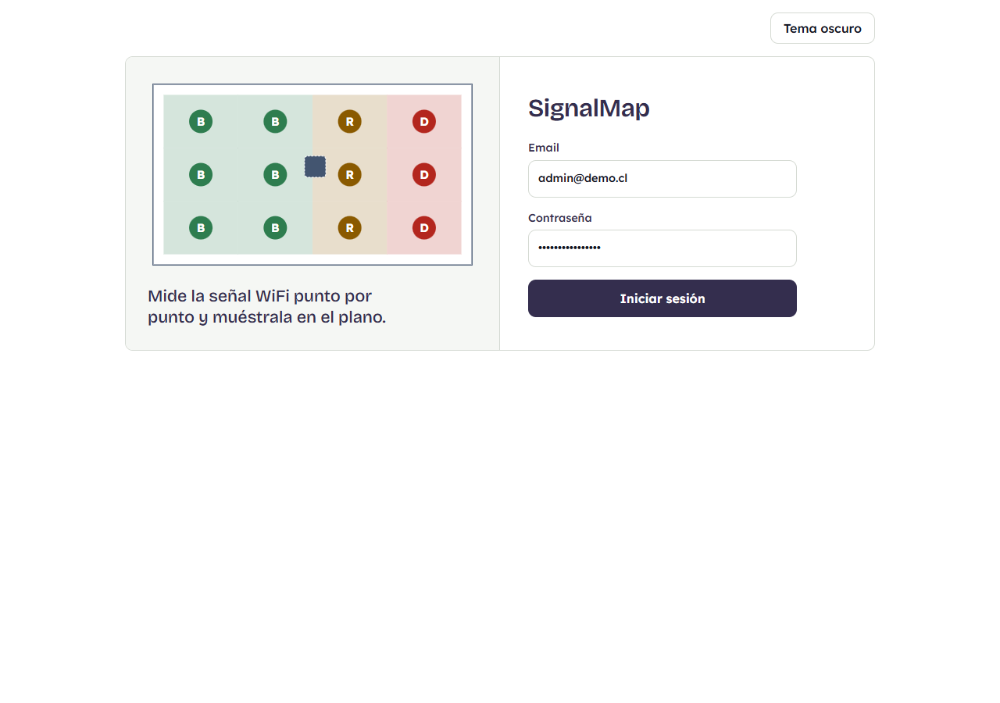
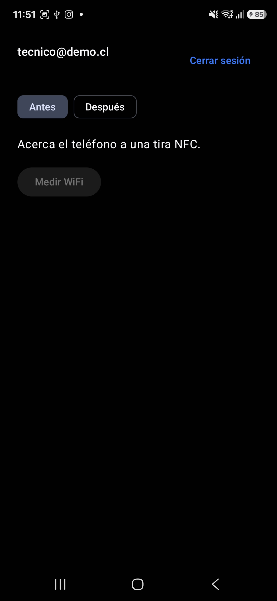
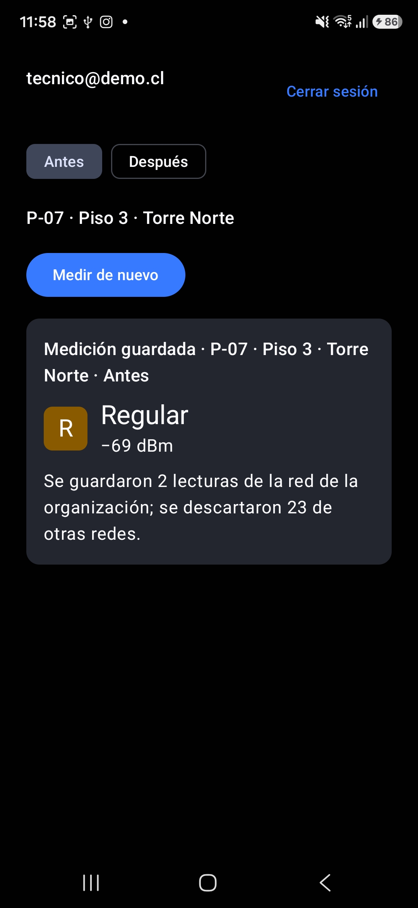
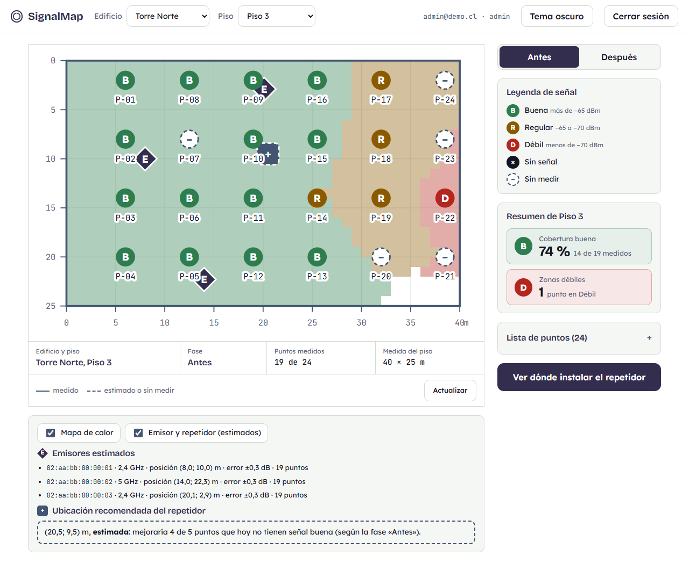
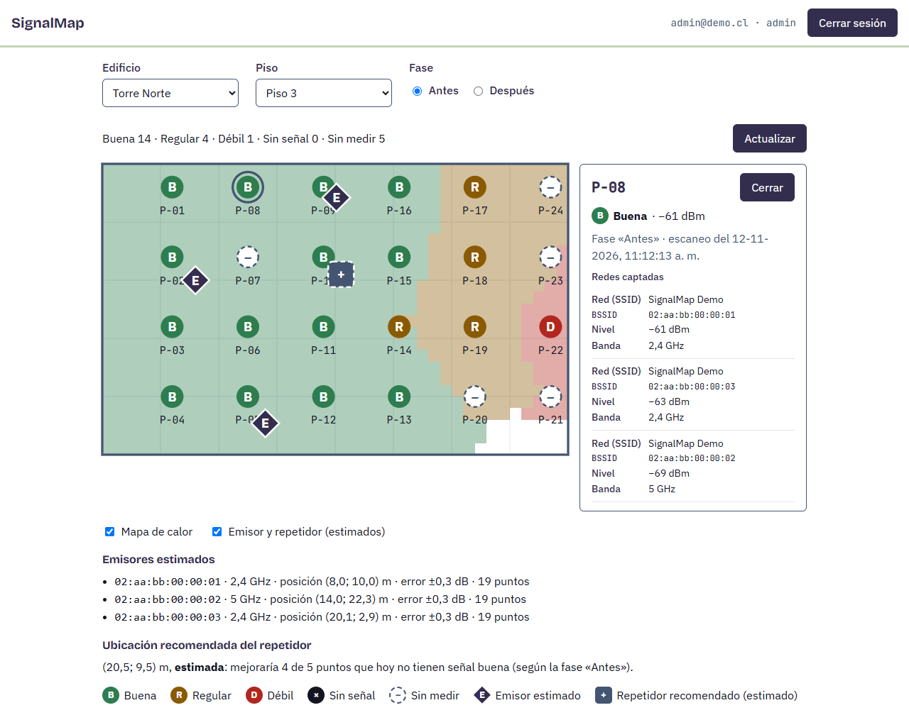
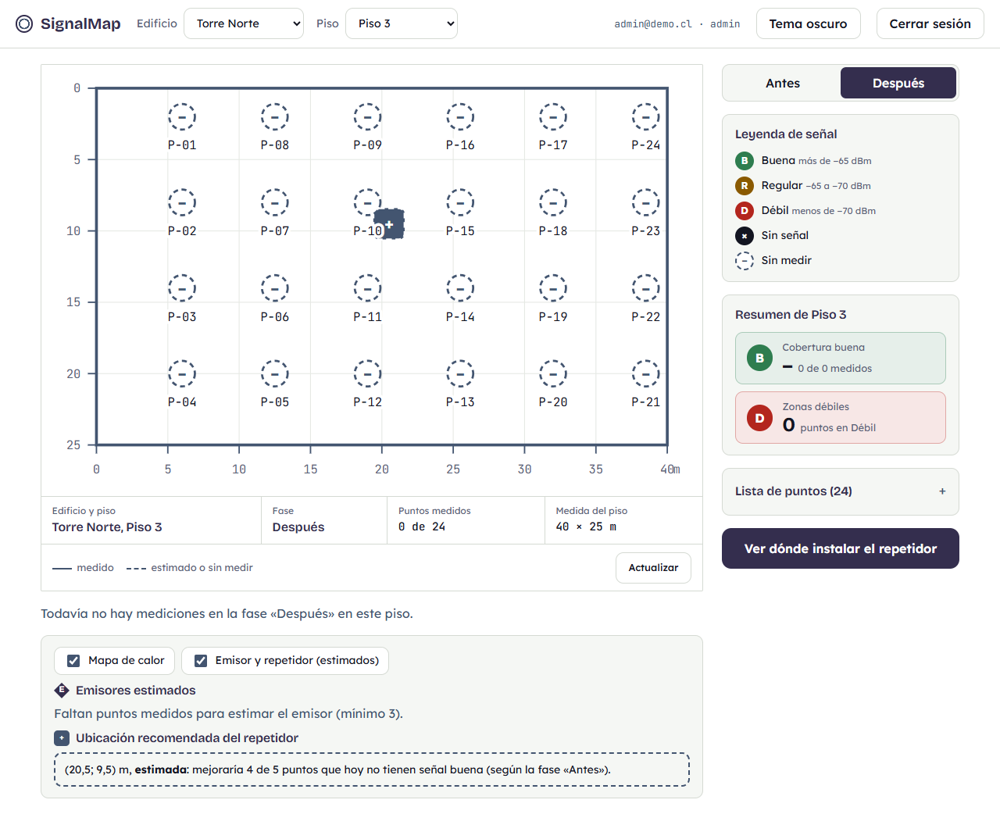
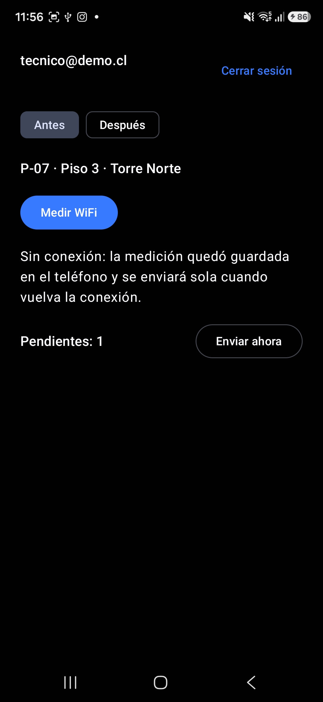

# Manual de uso e instalación de SignalMap

Este manual permite instalar SignalMap en un equipo nuevo y recorrer el flujo principal sin ayuda del equipo: **medir un punto con una tira NFC desde el teléfono, verlo pintado en el plano de la web y comprobar que el dato sigue ahí después de recargar la página**. No repite los README de cada carpeta: los enlaza donde corresponde.

Hay dos formas de conectar el teléfono con el servicio:

- **Con cable USB (camino principal).** Es corta, no necesita certificados y es la que se usa en la demostración. Todo este manual, salvo la sección 7, describe este camino.
- **Por WiFi, sin cable (opcional).** Exige HTTPS con una autoridad certificadora propia. Está en la sección 7 y solo conviene si el cable no es posible.

## 1. Requisitos

- **Sistema operativo:** Windows 11 o equivalente.
- **Node.js 26 o superior** (`node -v`). La versión está fijada en [`backend/.nvmrc`](../backend/.nvmrc).
- **PostgreSQL 17 o superior**, con `psql` disponible en la terminal (el instalador de Windows no lo agrega al `PATH`; ver [`db/README.md`](../db/README.md)).
- **Git**, para clonar el repositorio.
- **Teléfono Android 10 o superior** con NFC, con las opciones de desarrollador y la **depuración USB** activadas y el equipo autorizado en el teléfono.
- **`adb`** (herramientas de plataforma de Android, *platform-tools*). En Windows suele quedar en `%LOCALAPPDATA%\Android\Sdk\platform-tools`; si no está en el `PATH`, se escribe la ruta completa.
- **Tres tiras NFC** de la demostración (ver sección 3) y la red WiFi que se va a medir.
- **Android Studio** solo si se quiere compilar la app. Para solo usarla basta el APK ya compilado (sección 2.7).

## 2. Instalación paso a paso

Todos los comandos se escriben en una terminal (PowerShell, cmd o Git Bash) y, salvo que se indique otra cosa, desde la raíz del repositorio.

### 2.1 Obtener el código

```bash
git clone https://github.com/Signali/MapeoWifiSignal.git
cd MapeoWifiSignal
```

### 2.2 Crear la base de datos

Seguir los pasos 1 a 3 de [`db/README.md`](../db/README.md): crear el rol `signalmap_user` y las bases `signalmap` y `signalmap_test`, cargar las tablas con `db/schema.sql` y comprobar que hay nueve. En Windows, antes de cargar `schema.sql`, hay que indicar la codificación (ver la falla 5.1):

```powershell
$env:PGCLIENTENCODING = "UTF8"
```

La clave que se elige para `signalmap_user` se usa de nuevo en el siguiente paso.

### 2.3 Crear el `.env`

```powershell
Copy-Item .env.example .env
```

En Git Bash o Linux: `cp .env.example .env`. Luego se abre `.env` y se completan las variables que explica el [README de la raíz](../README.md#cómo-crear-el-env). Las que importan para este manual:

- `DB_PASSWORD`: la clave de `signalmap_user` del paso anterior.
- `JWT_SECRET`: un secreto propio de al menos 32 caracteres (el README indica cómo generarlo). El servicio no arranca con el valor de ejemplo.
- `SEED_ADMIN_PASSWORD`, `SEED_TECNICO_PASSWORD` y `SEED_CLIENTE_PASSWORD`: las claves de los tres usuarios de prueba. Son las que se usan para iniciar sesión.
- **`SEED_WIFI_SSID`: el nombre exacto de la red WiFi de la sala, respetando mayúsculas y minúsculas.** Es el paso donde más se falla: el sistema solo guarda las lecturas de esa red y descarta las demás. Si el nombre no coincide, todos los puntos quedan «Sin señal» (falla 5.3).
- `TLS_CERT_FILE` y `TLS_KEY_FILE`: **deben quedar vacías** para el camino con cable (así vienen en `.env.example`). Con ellas completas, el servicio habla solo HTTPS y la app, que por cable usa `http://127.0.0.1:3000`, no se conecta.

El `.env` no se sube a git y no se comparte por ningún medio.

### 2.4 Cargar los datos de prueba

```bash
cd backend
npm install
npm run seed
```

Debe terminar con `Seed cargado en la base "signalmap".`. **El seed borra y vuelve a cargar todos los datos de esa base, incluidas las mediciones.** Se corre antes de una revisión, nunca durante ella.

En PowerShell, si `npm` responde que la ejecución de scripts está deshabilitada, se corre una vez `Set-ExecutionPolicy -Scope CurrentUser RemoteSigned`, o se escribe `npm.cmd` en lugar de `npm`.

### 2.5 Compilar la web

```bash
cd ../frontend
npm install
npm run build
```

Termina con `built in …`. No hace falta un servidor aparte: el mismo servicio entrega la web compilada.

### 2.6 Iniciar el servicio

```bash
cd ../backend
npm start
```

Debe escribir `SignalMap API escuchando en el puerto 3000 (development, HTTP)`. Para comprobarlo, abrir `http://localhost:3000/health` en el navegador: responde `{"status":"ok"}`. La web está en `http://localhost:3000/`. El servicio queda corriendo en esa terminal; se detiene con `Ctrl+C`. Si dice `HTTPS` en lugar de `HTTP`, el `.env` tiene las variables `TLS_*` completas: vaciarlas y reiniciar. (No sirve vaciarlas con `$env:TLS_CERT_FILE = ""` en PowerShell: eso elimina la variable y el `.env` vuelve a aplicarse.)

### 2.7 Instalar la app en el teléfono

Con el teléfono conectado por USB y autorizado (`adb devices` lo debe mostrar como `device`):

1. Descargar `app-debug.apk` del *Release* más reciente de la sección [*Releases*](https://github.com/Signali/MapeoWifiSignal/releases) del repositorio.
2. Instalarlo:
   ```bash
   adb install -r app-debug.apk
   ```
   (alternativa: copiar el archivo al teléfono y abrirlo, permitiendo instalar desde esa fuente).

Para compilar el APK en lugar de descargarlo: [`android/README.md`](../android/README.md).

> **Recuadro: instalar sobre una versión anterior.** Si el teléfono ya tiene SignalMap instalada y el APK nuevo se compiló **en otro equipo**, Android lo rechaza porque la firma de depuración es distinta en cada computador (`INSTALL_FAILED_UPDATE_INCOMPATIBLE`). Hay que **desinstalar primero** y luego instalar:
> ```bash
> adb uninstall cl.signalmap.app
> adb install app-debug.apk
> ```
> Al desinstalar se borran la sesión y las mediciones pendientes del teléfono. En el mismo equipo donde se compiló, `adb install -r` basta.

### 2.8 Conectar el teléfono con el servicio

```bash
adb reverse tcp:3000 tcp:3000
```

Con esto, el `127.0.0.1:3000` del teléfono llega al servicio del computador, y la app ya trae esa dirección por defecto en el campo «Servidor». **El túnel se pierde al desconectar el cable o reiniciar `adb`: hay que repetir el comando** (falla 5.2).

Antes de medir, en el teléfono: **NFC activado**, **WiFi encendido** (aunque no se use para el servicio) y **ubicación encendida**. La app pide el permiso de ubicación la primera vez, y hay que elegir «Ubicación precisa»: Android la exige para entregar las redes WiFi, y SignalMap no guarda la ubicación, solo las redes que capta.

## 3. Usuarios y datos de prueba

`npm run seed` crea una organización ficticia, dos edificios y tres usuarios. Las claves son las que se escribieron en el `.env`; no hay ninguna fija en el repositorio.

| Email | Rol | Clave | Qué puede hacer |
|---|---|---|---|
| `admin@demo.cl` | `admin` | `SEED_ADMIN_PASSWORD` | Todo, en la web y en la app |
| `tecnico@demo.cl` | `tecnico` | `SEED_TECNICO_PASSWORD` | Medir y ver, en la web y en la app |
| `cliente@demo.cl` | `cliente` | `SEED_CLIENTE_PASSWORD` | Solo ver, **solo en la web** (la app lo rechaza) |

Para medir se usa `tecnico@demo.cl` en la app; para ver, `admin@demo.cl` en la web.

El edificio que se mide es **Torre Norte**, con un único piso, **Piso 3** (40 m × 25 m), y **24 puntos** (`P-01` a `P-24`) en una grilla de seis columnas y cuatro filas. El segundo, **Oficinas Centro**, no tiene pisos ni puntos y no está asignado al usuario `cliente` (que por eso no lo ve): aparece en el selector de la web y no hay que medirlo. Después del seed **ningún punto tiene mediciones**. Tres puntos corresponden a tiras NFC reales; el resto tiene códigos inventados que ninguna tira reproduce (están en [`db/seed.sql`](../db/seed.sql)).

| Punto | Posición en el plano (m) | UID de la tira |
|---|---|---|
| `P-07` | (12,5; 8,0) | `04C7DC7FBF2A81` |
| `P-08` | (12,5; 2,0) | `04D3DC7FBF2A81` |
| `P-09` | (19,0; 2,0) | `04D2DC7FBF2A81` |

`P-07` queda sin medir a propósito: es el que se mide durante la demostración y el que pasa de «Sin medir» a tener color.

## 4. Uso: el recorrido completo

El recorrido pasa por la web, la app y la web otra vez. Con el servicio iniciado (2.6), la app instalada y el túnel activo (2.8):

1. **Mirar la web.** Abrir `http://localhost:3000/` e iniciar sesión con `admin@demo.cl`. En la cabecera se elige el edificio «Torre Norte» y el piso «Piso 3»; a la derecha, la fase «Antes». El plano muestra los 24 puntos como un círculo punteado con un guion (la leyenda lo rotula «Sin medir»); bajo el plano, el cajetín dice «Puntos medidos 0 de 24» y la tarjeta «Cobertura buena» aparece vacía (–). La regla visual de toda la web y de la app es: **línea continua = medido; línea punteada = estimado, pendiente o sin medir**. El botón «Tema oscuro» (o «Tema claro») de la cabecera cambia el aspecto; sin elegir, sigue el tema del sistema.

   

2. **Medir con la app.** Abrir SignalMap en el teléfono, iniciar sesión con `tecnico@demo.cl` (el campo «Servidor» ya dice `http://127.0.0.1:3000`), dejar elegida la fase «Antes» y ver la ficha punteada con el mensaje «Acerca el teléfono a una tira NFC.». Acercar el teléfono a la tira del `P-07`: la ficha pasa a mostrar el código grande (`P-07`) y el lugar («Piso 3, Torre Norte»), y se habilita **«Medir WiFi»**, el botón fijo en la parte baja de la pantalla. Al tocarlo busca las redes («Buscando redes WiFi…») y envía la medición. El resultado es un bloque del color de la categoría, con su letra dentro del círculo, el nombre (por ejemplo, «Regular») y el nivel (−69 dBm); debajo dice «Medición guardada, fase «Antes».» y cuántas lecturas de la red de la organización se guardaron y cuántas de otras redes se descartaron. «Medir de nuevo» repite la medición del mismo punto.

   
   

3. **Ver el resultado en la web.** Volver a la web y presionar **«Actualizar»** (en el pie del plano). El `P-07` aparece pintado como **Buena** (B), **Regular** (R) o **Débil** (D), según el nivel de señal medido (más fuerte que −65 dBm, entre −65 y −70 dBm, o más débil que −70 dBm; la leyenda de la derecha lo recuerda). El cajetín pasa a «Puntos medidos 1 de 24» y las tarjetas del resumen se actualizan. Al hacer clic en el punto se abre su detalle bajo el plano: categoría, nivel, fecha y redes captadas. También se puede elegir un punto desde la «Lista de puntos» de la derecha, que está plegada.

   
   

4. **Recargar.** Presionar `F5`. La selección (edificio, piso y fase) está en la dirección de la página y el dato viene de la base de datos, así que el punto sigue pintado. Esa es la comprobación de que el dato **persiste**.

5. **Medir más puntos.** Repetir el paso 2 con las tiras de `P-08` y `P-09` y volver a presionar «Actualizar». Con tres puntos medidos de la misma red ya se pueden estimar los emisores.

6. **Análisis del piso** (debajo del plano, en la misma pantalla; el botón «Ver dónde instalar el repetidor» de la derecha lleva hasta este panel):
   - **Mapa de calor:** colorea el interior del piso interpolando entre los puntos medidos. Se oculta con la casilla «Mapa de calor».
   - **Emisores estimados:** la posición probable de cada punto de acceso de la red, calculada por trilateración. Aparece cuando al menos **3 puntos** captaron ese emisor; con menos, la web lo dice («Faltan puntos medidos para estimar el emisor (mínimo 3).»).
   - **Ubicación recomendada del repetidor:** un punto del plano donde un repetidor mejoraría la mayor cantidad de puntos que hoy no tienen señal buena. **Siempre se rotula «estimada»**: es un cálculo a partir de las mediciones, no una comprobación. Si todos los puntos medidos ya tienen señal buena, la web lo dice en lugar de recomendar una posición.

   Con pocos puntos medidos, o con todos en «Buena», la recomendación puede no aparecer: es el comportamiento esperado.

**Solo existe la fase «Antes» en la demostración.** La fase «Después» está en la base, en la API y en la web (el selector la ofrece y, sin mediciones, muestra «Todavía no hay mediciones en la fase «Después» en este piso.»), pero no se probó con un repetidor real. Se declara como limitación.



### Medir sin conexión

La app guarda en el teléfono las mediciones que no pudo enviar y las envía cuando vuelve la conexión. Con cable no se puede simular con el modo avión (ver la sección 8); lo que se hace es quitar el túnel:

1. `adb reverse --remove tcp:3000`
2. Medir un punto con la app. Aparece «Sin conexión: la medición quedó guardada en el teléfono y se enviará sola cuando vuelva la conexión.» y una tarjeta de borde punteado con el contador «Pendientes: 1» y el botón «Enviar ahora».

   

3. Restaurar el túnel con `adb reverse tcp:3000 tcp:3000` y tocar **«Enviar ahora»**. La medición se envía con la hora real del escaneo y, si se reenvía, no se duplica.

La cola solo se envía con la app abierta; no hay envío en segundo plano. Detalle en [`android/README.md`](../android/README.md).

## 5. Las tres fallas más frecuentes

### 5.1 `psql` se detiene con «0x8d … WIN1252»

**Síntoma.** Al cargar `db/schema.sql` en Windows, `psql` termina con `carácter con secuencia de bytes 0x8d en codificación «WIN1252» no tiene equivalente en la codificación «UTF8»` y no queda ninguna tabla.

**Solución.** Indicar que el archivo está en UTF-8 y repetir el comando. En PowerShell, `$env:PGCLIENTENCODING = "UTF8"`; en cmd, `set PGCLIENTENCODING=UTF8`. Vale solo para esa terminal. Ver [`db/README.md`](../db/README.md), paso 2.

### 5.2 La app dice «No se pudo conectar con el servidor»

**Síntoma.** Al iniciar sesión o al enviar, la app muestra «No se pudo conectar con el servidor. Revisa la dirección y que el teléfono esté conectado (cable con adb reverse o la misma red WiFi).».

**Solución.**
- **Con cable:** el túnel se perdió al reconectar el cable. Repetir `adb reverse tcp:3000 tcp:3000` y comprobar que el servicio sigue corriendo (`http://localhost:3000/health`). Si el `.env` tiene `TLS_*` completas, el servicio habla solo HTTPS y esta dirección no funciona (2.3).
- **Por WiFi:** usar `https://<IP del computador>:3000` en el campo «Servidor» (sección 7) y revisar, en este orden: (1) el teléfono tiene que haber **iniciado sesión en el portal cautivo** de la red, si la tiene (el ícono de WiFi con «?» lo delata); (2) los **datos móviles deben estar apagados**: si la WiFi no tiene internet validado, Android manda el tráfico por datos móviles y no llega a un servidor local; (3) permitir el puerto en el Firewall de Windows si la red es «pública».

La app muestra este mismo mensaje ante cualquier fallo de conexión, incluido un certificado rechazado; si falla por WiFi, probar de nuevo antes de buscar otra causa.

### 5.3 «Android rechazó la búsqueda de redes» o «Sin señal» en todos los puntos

**Síntoma.** O bien la app dice «Android rechazó la búsqueda de redes (límite de 4 cada 2 minutos). Espera un momento y vuelve a intentar.», o bien las mediciones se guardan pero todos los puntos quedan en «Sin señal».

**Solución.**
- **Límite de búsquedas.** Android permite 4 búsquedas de WiFi cada 2 minutos. Basta esperar el tiempo que indica la app. Para quitar el límite, en el teléfono: Opciones de desarrollador → desactivar **«Limitación de búsqueda de Wi-Fi»**.
- **Nombre de red distinto.** `SEED_WIFI_SSID` no coincide con el nombre real de la red, o difiere en una mayúscula, un espacio o una tilde. Es un caso real: con `Wifi_Sala` en el `.env` y la red llamada `WiFi_Sala` (una sola mayúscula de diferencia), la app mostró «Sin señal», «Se guardaron 0 lecturas de la red de la organización; se descartaron 33 de otras redes». El nombre se copia tal cual desde los ajustes WiFi del teléfono. Corregirlo en el `.env`, volver a correr `npm run seed` (que borra las mediciones anteriores) y medir de nuevo.

## 6. Datos que conviene conocer

- **Reloj del teléfono.** El servicio rechaza (`422`) una medición cuya fecha de escaneo esté más de 5 minutos en el futuro o más de 30 días en el pasado. Si el reloj del teléfono está muy adelantado, la app muestra «El servidor no aceptó la medición.». Un desfase de segundos no importa.
- **Tira desconocida.** Una tira que no es de la demostración muestra «Esta tira no está registrada en SignalMap.».
- **Cuenta `cliente` en la app.** Muestra «Esta app es para técnicos y administradores. Con una cuenta de cliente, usa la web.».

## 7. Uso sin cable (opcional)

Con el cable, el tráfico llega a `127.0.0.1` y no sale del cable, por lo que no se cifra. Por WiFi sí sale del computador y debe ir cifrado. Por eso este camino exige HTTPS con una autoridad certificadora (CA) propia de la demostración. Detalle completo en [`backend/README.md`](../backend/README.md), sección *HTTPS*.

1. **Requisito:** `openssl` (viene con Git Bash). Computador y teléfono en la misma red WiFi.
2. **Certificados**, desde la raíz y con la IP del computador en esa red (se ve con `ipconfig`):
   ```bash
   bash backend/scripts/tls-certs.sh <IP>
   ```
   La primera vez crea la CA en `certs/` y copia su certificado público a la app (`android/app/src/main/res/raw/signalmap_ca.crt`). Cada vez emite un certificado del servidor válido 30 días para `localhost`, `127.0.0.1` y esa IP.
3. **`.env`:** `TLS_CERT_FILE=certs/server.crt` y `TLS_KEY_FILE=certs/server.key`. Al iniciar, el servicio dice `(development, HTTPS)`. **Con estas variables el servicio escucha solo en HTTPS**: para volver al camino con cable hay que vaciarlas y reiniciar.
4. **App:** en el campo «Servidor», `https://<IP>:3000`.
5. **Firewall:** si la red de Windows es «pública», permitir el puerto con `netsh advfirewall firewall add rule name="SignalMap" dir=in action=allow protocol=TCP localport=3000`, en un PowerShell de administrador.

Qué hay que saber:

- **La CA es de un solo equipo.** El APK del *Release* confía únicamente en la CA creada en Pc-Portatil; la clave privada (`certs/ca.key`) no está en el repositorio. En cualquier otro computador, al correr el script se crea una CA propia que reemplaza `signalmap_ca.crt`, y **hay que recompilar e instalar la app** para que la acepte (el archivo aparecerá modificado en git; no es necesario subirlo). Con cable, nada de esto hace falta.
- **El certificado del servidor dura 30 días.** Si venció, se vuelve a correr el script con la misma IP y se reinicia el servicio. Si cambia la red, se corre con la IP nueva; la app no cambia.
- **Portal cautivo y datos móviles.** Es lo que falló en la prueba real del 12/11 en la red de la universidad: el teléfono estaba conectado a la WiFi pero sin iniciar sesión en su portal, y Android usaba los datos móviles como red principal, así que la dirección local del computador era inalcanzable. Se resolvió iniciando sesión en el portal y apagando los datos móviles. Con eso, la medición llegó por HTTPS sin ningún cable. Conviene volver a activar los datos móviles al terminar.
- **Aislamiento de clientes.** Muchas redes WiFi públicas o de salas (y los puntos de acceso de invitados) impiden que dos dispositivos se vean entre sí. Si el teléfono no llega al computador aunque el portal esté resuelto y los datos móviles apagados, esa es la causa más probable; con cable no ocurre.
- **La web y el teléfono a la vez.** Con TLS activo, el navegador avisa de un certificado no confiable en `https://localhost:3000`. Para usar la web sin aviso y el teléfono por WiFi se pueden levantar dos instancias (ver `backend/README.md`).

## 8. Trampas del entorno

- **El modo avión no corta el servicio.** `adb reverse` viaja por el cable USB, no por la red del teléfono. Para simular «sin servidor» hay que quitar el túnel (`adb reverse --remove tcp:3000`) y restaurarlo después.
- **`curl` en Windows con la CA propia:** `curl --ssl-no-revoke --cacert certs/ca.crt https://127.0.0.1:3000/health`. Sin `--ssl-no-revoke`, Windows intenta comprobar la revocación del certificado y falla.
- **Compilar la app (Gradle):** `JAVA_HOME` debe apuntar a la carpeta `jbr` de Android Studio, y `adb` está en `%LOCALAPPDATA%\Android\Sdk\platform-tools`.
- **Reloj del teléfono:** ver la sección 6.
- **Git Bash:** para terminar un proceso por número, `taskkill //PID <n> //F` (con las barras duplicadas).

## 9. Qué no cubre este manual

Quedan fuera, declarados como limitaciones en el documento final: la renovación del token (al vencer hay que iniciar sesión de nuevo), la gestión de usuarios (solo por seed), el envío de mediciones en segundo plano, Docker, la publicación en la nube y los tests automatizados de la web. La fase «Después» no se comprobó con un repetidor real.

Otras guías: [README de la raíz](../README.md) (resumen de instalación), [`backend/README.md`](../backend/README.md), [`android/README.md`](../android/README.md), [`frontend/README.md`](../frontend/README.md), [`db/README.md`](../db/README.md) y [`postman/README.md`](../postman/README.md) (probar solo la API).
